# Capri – Guide d'utilisation

| Language | Version |
|:---------|:--------|
| 🇫🇷 Français | **[GUIDE_UTILISATION.md](GUIDE_UTILISATION.md)** (cette page) |
| 🇬🇧 English | **[USER_GUIDE.md](USER_GUIDE.md)** |

<p align="center">
  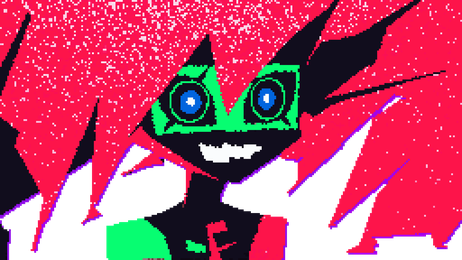
</p>

## 1. Vue d'ensemble

Capri est une entité numérique née dans le cyberespace (inspirée de Capri, *Cyberpunk: Edgerunners*). Elle flotte sur
ton écran, t'écoute en permanence, te répond à voix haute et pilote ton PC. Elle apparaît, disparaît et se téléporte
d'elle-même dans des éclairs roses et verts, et dit parfois des phrases tirées de `phrases.txt`. Ce guide t'apprend à
la lancer, à lui parler, à régler son comportement et à résoudre les problèmes courants.

---

## 2. Ce que tu vas apprendre

| Compétence | Tu sais... |
|:-----------|:-----------|
| Lancer Capri | Démarrer depuis le raccourci du bureau et retrouver son icône |
| Lui parler | L'appeler par son nom, avec ou sans demande, même quand elle est cachée |
| Donner des ordres | Ouvrir des applications, chercher sur le web, régler le volume, verrouiller le PC |
| Régler son comportement | Choisir ses positions, la vitesse des éclairs et à quel point elle parle |
| Personnaliser | Modifier ses phrases, sa voix et connecter un modèle de langage |
| Dépanner | Diagnostiquer une écoute capricieuse ou un démarrage raté |

---

## 3. Avant de commencer

| Élément | À vérifier |
|:--------|:-----------|
| Système | Windows 10 ou 11 |
| Python | 3.12 installé (`python --version`) |
| Dépendances | `installer_dependances.bat` exécuté une fois (voir `requirements.txt`) |
| Voix | `capri_french.safetensors` à côté de `assistant_vocal.py` |
| Micro | Autorisé pour les applications de bureau (`verifier_permissions_micro.bat`) |
| Internet | Nécessaire pour la reconnaissance vocale (Google) |

---

## 4. Étapes

### Étape 1 – Lancer Capri

Démarre Capri depuis le bureau. (1 min)

1. **Double-clique sur le raccourci `Capri` du bureau** (créé par `creer_raccourci_bureau.bat`).
2. Capri apparaît dans un éclair rose et vert.
3. Une icône se place dans la zone de notification (icônes cachées, à côté de l'horloge).

| Icône | Utilisée pour |
|:------|:--------------|
| `icon.ico` | Raccourci du bureau |
| `icon.png` | Zone de notification |
| `capri.ico` | Fenêtre de Capri |

> [!TIP]
> Pour changer les icônes, remplace ces fichiers puis relance `creer_raccourci_bureau.bat`. Relancer le raccourci
> alors qu'elle tourne déjà ne crée pas de doublon : elle se montre simplement.

**Point de contrôle :** Capri est visible à l'écran et son icône est dans la zone de notification.

### Étape 2 – Lui parler

<p align="center">
  
</p>

Capri **écoute en permanence**, même cachée, mais elle n'obéit que si tu dis son nom. (5 min)

1. Dis **« Capri »** suivi de ta demande : *« Capri, quelle heure est-il ? »*
2. Ou dis **« Capri »** seul, attends environ 1 seconde (elle apparaît si elle était cachée, ses yeux passent au vert),
   puis fais ta demande. Elle l'attend pendant 10 secondes sans parler, pour ne pas te couvrir.

Sans son nom, tout est ignoré (seule exception : le numéro à choisir quand elle te propose une liste d'applications).

| Tu dis | Capri |
|:-------|:------|
| « Salut Capri » | Tiens, un signal entrant. Salut. Qu'est-ce qu'on explore aujourd'hui ? |
| « Capri, tu vas bien ? » | Tous mes processus tournent correctement... |
| « Capri, tu connais Python ? » | Quelques millions de lignes de code plus tard... |

> [!NOTE]
> La reconnaissance vocale entend parfois « café », « tapis » ou « prix » à la place de « Capri ». Capri :
> - accepte ces mots comme son nom **uniquement au début de la phrase** (`alias_debut`) : « recherche Capri sur
>   internet » ne la réveille donc pas ;
> - accepte aussi les mots de `alias_si_ordre` (« prix », « pris », « pays »...) **seulement si la suite est une
>   commande connue** (« prix recherche github » fonctionne) ;
> - réécoute séparément le début de ta phrase, où le nom est le mieux reconnu, et examine plusieurs interprétations.

> [!IMPORTANT]
> Elle est **sourde pendant qu'elle parle**. Des délais très courts entre ses initiatives la font parler sans arrêt
> et donc te rater.

**Point de contrôle :** « Capri, quelle heure est-il ? » obtient une réponse parlée avec l'heure.

### Étape 3 – Donner des ordres

<p align="center">
  
</p>

| Catégorie | Exemples |
|:----------|:---------|
| **Infos** | « Capri, quelle heure est-il », « Capri, quel jour on est » |
| **Applications** | « Capri, ouvre Chrome », « lance Spotify », « ouvre la calculatrice », « ferme Discord » |
| **Web** | « Capri, recherche chats mignons », « cherche des recettes sur YouTube », « ouvre YouTube » |
| **Son** | « Capri, monte le volume », « baisse le volume », « volume 40 », « coupe le son », « remets le son » |
| **Système** | « Capri, fais une capture d'écran », « verrouille la session », « éteins le PC » (10 s, « annule » pour annuler) |
| **Capri** | « Capri, quitte » / « ferme-toi » (elle se ferme), « au revoir » (elle reste là) |

**Point de contrôle :** « Capri, recherche youtube » ouvre une recherche dans le navigateur.

### Étape 4 – Apparitions, éclairs et phrases spontanées

Capri n'est pas obligée de rester sur l'écran : de temps en temps, **sans qu'on lui ait rien demandé**, elle disparaît,
réapparaît à une **position aléatoire de l'écran**, se téléporte ou dit une phrase. Cachée, elle peut laisser **ses
éclairs traverser l'écran** sans se montrer. Si tu la caches toi-même (clic droit sur l'icône), elle reste cachée
jusqu'à ce que tu dises « Capri ». (10 min)

Ouvre `capri_config.json` (créé au premier lancement) et ajuste :

| Clé | Rôle | Défaut |
|:----|:-----|:-------|
| `avatar.duree_teleportation` / `duree_apparition` / `duree_disparition` | Durée des éclairs en secondes (plus petit = plus rapide) | 0.6 / 0.5 / 0.45 |
| `avatar.positions` | `aleatoire` (n'importe où) ou `bas_droite`, `bas_gauche`, `haut_droite`, `haut_gauche`, `centre` (mélangeables, répéter un nom augmente ses chances) | `["aleatoire"]` |
| `avatar.eclairs_cachee` | Éclairs qui traversent l'écran pendant qu'elle est cachée | `true` |
| `avatar.eclairs_secondes` | Délai min/max entre deux éclairs | `[6, 25]` |
| `avatar.expressions_auto` | `false` : elle garde toujours la même expression | `true` |
| `phrases.visible_secondes` / `cachee_secondes` | Délai min/max avant sa prochaine initiative | `[30,120]` / `[15,75]` |
| `phrases.probabilite` | Chance de dire une phrase à chaque apparition/disparition | `0.8` |
| `phrases.bavardage` | `false` : plus de phrases sans bouger | `true` |
| `phrases.niveau_parole` | `silencieuse`, `discrete`, `normale`, `bavarde` (aussi dans le menu) | `normale` |

#### Le fichier `phrases.txt`

Texte brut, modifiable avec le Bloc-notes, **relu automatiquement** (pas besoin de relancer Capri) :

- **Une ligne = une réplique**, qui peut contenir plusieurs phrases (dites d'une traite).
- Les lignes vides et celles qui commencent par `#` sont ignorées.
- `[apparition]`, `[disparition]`, `[deplacement]`, `[bavardage]` seuls sur une ligne ouvrent une section. Les lignes
  avant le premier titre servent de secours pour toutes les sections.
- Une humeur facultative peut précéder la réplique : `[enthousiaste] Coucou !` (`neutre`, `enthousiaste`, `taquine`,
  `agacee`, `suspicieuse`, `moi`, `montre`, `detendue`, `content`, `surprise`).

```text
[apparition]
[enthousiaste] Tiens, me revoilà dans le flux !
[bavardage]
[taquine] Tu sais, de là où je suis, ton écran ressemble à une ville pleine de lumières.
```

**Point de contrôle :** avec `niveau_parole` à `bavarde`, elle apparaît, disparaît et parle sans que tu aies rien dit.

### Étape 5 – L'avatar et le menu de l'icône

| Action sur l'avatar | Effet |
|:--------------------|:------|
| **Clic gauche** | Elle réagit |
| **Double-clic** | Comme si tu disais « Capri » seul |
| **Glisser** | La déplacer |
| **Clic droit** | Mini-menu (cacher, se téléporter, voix, pause, quitter) |

| Enthousiaste | Agacée | Soupçonneuse | Détendue |
|:---:|:---:|:---:|:---:|
| 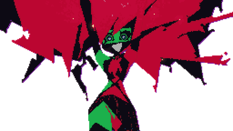 |  |  | 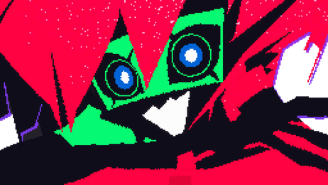 |

Elle change d'expression selon la situation, sa bouche suit sa voix, et ce qu'elle dit s'affiche en bulle néon.

Menu de l'icône (clic gauche : afficher / cacher ; clic droit : menu) :

| Entrée | Rôle |
|:-------|:-----|
| Afficher / Cacher Capri | Bascule l'affichage |
| **Se téléporter** | Bas/haut, gauche/droite, centre, au hasard |
| **Taille** | Petite, moyenne, grande |
| Apparitions / déplacements automatiques, bulles de texte | Cases à cocher |
| Cliquable | Désactivé : les clics traversent Capri |
| **Voix** | Activer / couper (elle continue alors en sous-titres) |
| **Choix de la voix** | Automatique, voix de Capri, Piper, Windows, Edge (elle dit une phrase pour l'essayer) |
| **Elle parle...** | Jamais d'elle-même / rarement / normalement / beaucoup. Elle répond toujours quand on lui parle |
| Mettre en pause / Reprendre | Suspend l'écoute |
| Mode économie | Moins de ressources (automatique sur batterie) |
| Afficher le statut / Quitter | |

**Point de contrôle :** « Choix de la voix » puis une voix différente : elle dit une phrase pour l'essayer.

### Étape 6 – Choisir la voix

<p align="center">
  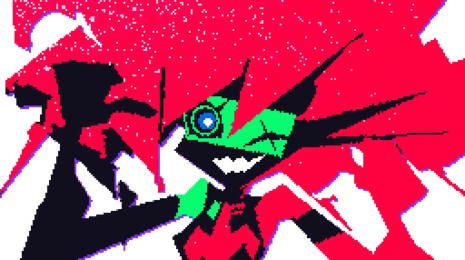
</p>

- Par défaut : **la voix de Capri**, générée hors ligne par Pocket-TTS à partir de `capri_french.safetensors`
  (`pip install pocket-tts`). Le modèle français de base est téléchargé une fois au premier lancement, puis mis en cache.
- Secours automatique : voix neuronale Piper (`installer_voix.py`, ≈ 65 Mo), puis voix Windows (Hortense).
- `capri_config.json` → `voix` : `moteur` (`auto`, `capri`, `local` pour Piper, `edge`, `windows`), `fichier_voix`,
  `volume`, `muet`. `vitesse` et `hauteur` ne s'appliquent qu'aux voix de secours.

### Étape 7 – Conversation libre (optionnel)

Sans configuration, Capri répond avec ses répliques intégrées et propose une **recherche web** pour les questions
ouvertes. Pour qu'elle discute librement avec la même personnalité, connecte un modèle de langage (API compatible
OpenAI) dans `capri_config.json`, section `llm` :

```json
"llm": {
  "actif": "auto",
  "url": "https://api.openai.com/v1",
  "modele": "gpt-4o-mini",
  "cle_env": "OPENAI_API_KEY"
}
```

- Mets ta clé dans la variable d'environnement `OPENAI_API_KEY` (de préférence au champ `cle`).
- **100 % local et gratuit** : installe [Ollama](https://ollama.com), puis `url` = `http://localhost:11434/v1`,
  `modele` = `llama3.1` (ou autre) et `"actif": true`.
- Toute API compatible fonctionne (GitHub Models, LM Studio, OpenRouter...).

---

## 5. Architecture et conception

### 5.1 Vue d'ensemble

Capri est un petit programme Python à **plusieurs threads** : un fil capte le micro, un autre reconnaît et interprète la
parole, un troisième lui donne des initiatives, pendant que l'avatar dessine sa fenêtre translucide et que l'icône de la
zone de notification tient le menu.

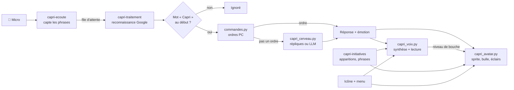

| Thread | Rôle |
|:-------|:-----|
| `capri-ecoute` | Lit le micro, découpe les phrases, jette le son pendant qu'elle parle |
| `capri-traitement` | Reconnaissance vocale, détection du nom, exécution de la demande |
| `capri-initiatives` | Disparaît, réapparaît, se téléporte, dit des phrases (`phrases.txt`) |
| Fenêtre de l'avatar | Dessin à ~30 images/s dans une fenêtre Windows translucide |
| Icône de notification | Menu, bascule des options |

### 5.2 De « Capri » à la réponse

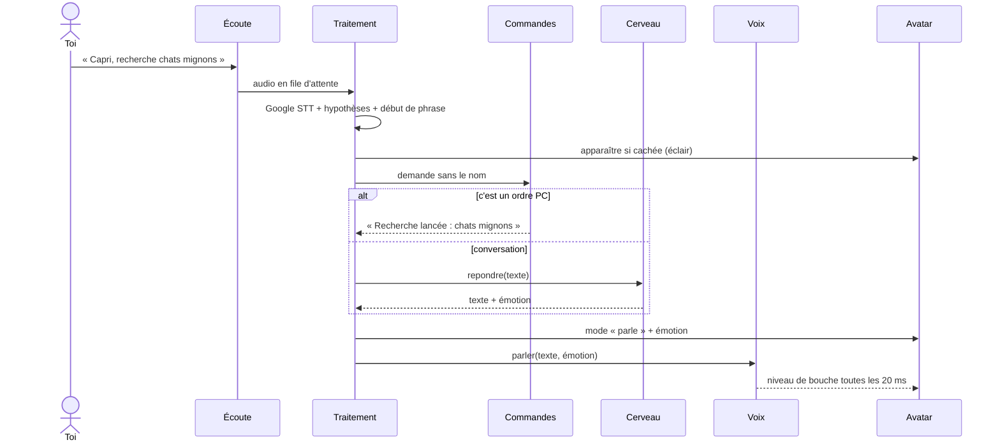

### 5.3 Reconnaissance du nom

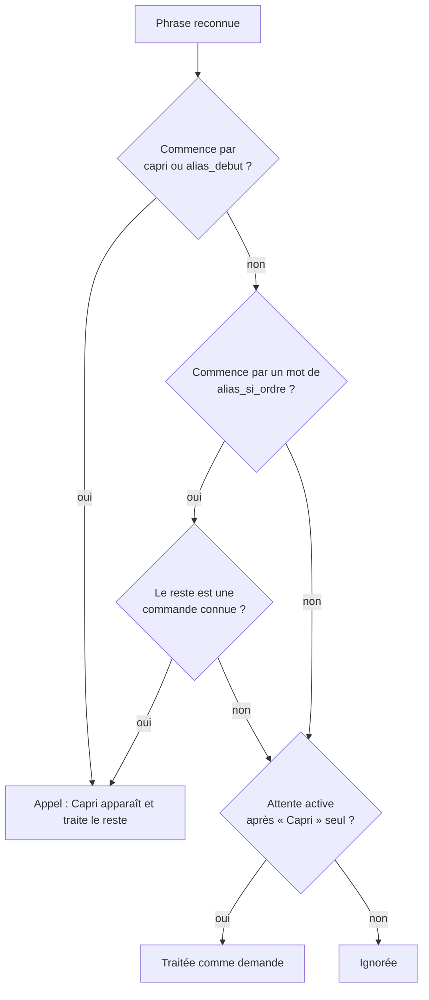

### 5.4 Choix de la voix

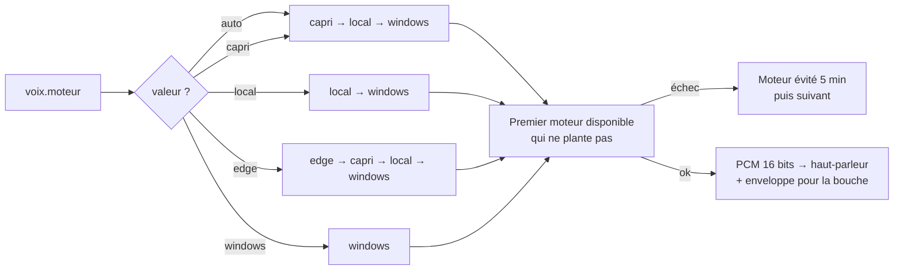

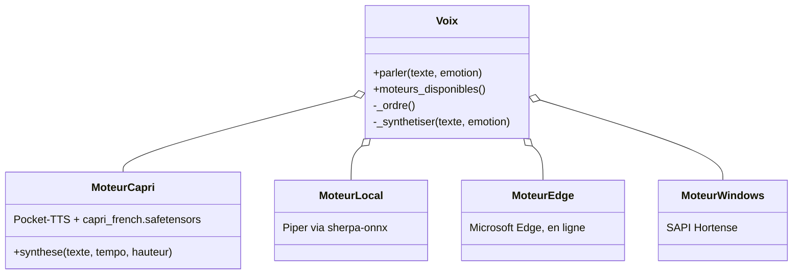

| Moteur | Hors ligne | Qualité | Réglages pris en compte |
|:-------|:----------:|:--------|:------------------------|
| `capri` (Pocket-TTS) | ✅ | Voix de Capri | `volume` |
| `local` (Piper) | ✅ | Bonne, voix de secours | `volume`, `vitesse`, `hauteur` |
| `edge` | ❌ | Très bonne | `volume`, `vitesse`, `hauteur` |
| `windows` (Hortense) | ✅ | Basique | `volume` |

### 5.5 Le cerveau : trois niveaux de réponse

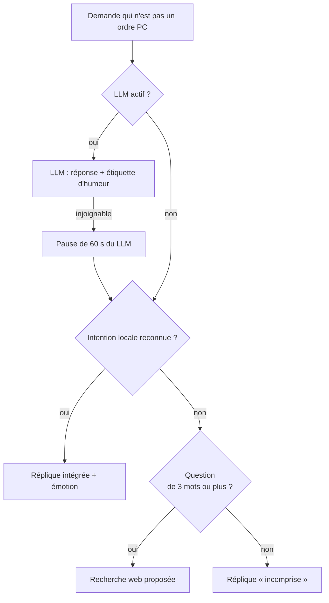

| Version | Configuration | Capacités |
|:--------|:--------------|:----------|
| **Intégrée** (défaut) | Aucune | Répliques écrites pour les intentions courantes (identité, humeur, code...), recherche web pour le reste |
| **LLM en ligne** | `llm.url` + clé dans `OPENAI_API_KEY` | Discussion libre, personnalité imposée par un prompt système |
| **LLM local** | Ollama, `url` = `http://localhost:11434/v1` | Idem, gratuit et hors ligne |

L'historique garde les 12 derniers messages ; le LLM reçoit la date et l'heure à chaque appel.

### 5.6 Émotions et expressions

Chaque réponse porte une **émotion** (du LLM via une étiquette entre crochets, ou de la réplique intégrée), qui choisit
le sprite. La bouche suit la voix en trois niveaux (fermée, mi-ouverte, ouverte).

| Étiquette | Sprite | Quand |
|:----------|:-------|:------|
| `[neutre]` | `interested` | Par défaut |
| `[enthousiaste]` | `excited` | Sujet qui lui plaît, ordre exécuté |
| `[taquine]`, `[suspicieuse]` | `suspicious` | Ironie, mystère sur sa nature |
| `[agacee]` | `annoyed` | Ordre non compris, échec |
| `[moi]` | `pointingatherself` | Elle parle d'elle |
| `[montre]` | `pointing` | Elle propose un choix ou indique quelque chose |
| `[detendue]` | `layingdown` | Départ, repos, sommeil |
| `[content]` | `happy` | Joie |
| `[surprise]` | `surprised` | Surprise |

Ces mêmes étiquettes s'écrivent dans `phrases.txt`. L'émotion règle aussi un peu la voix (tempo et hauteur) sur les
voix de secours.

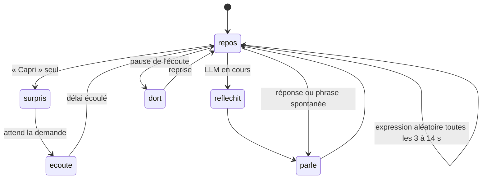

### 5.7 Initiatives spontanées

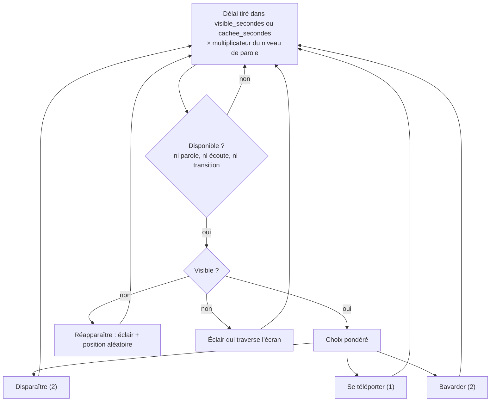

---

## 6. Référence technique

### 6.1 Modules

| Module | Classe / fonctions clés | Rôle |
|:-------|:------------------------|:-----|
| `assistant_vocal.py` | `AssistantVocal`, `Reconnaisseur` | Orchestration : micro, STT, menu, initiatives |
| `capri_avatar.py` | `AvatarCapri`, `FenetreCalque` | Fenêtre Win32 translucide (ctypes), sprites, éclairs |
| `capri_voix.py` | `Voix`, `MoteurCapri`, `MoteurLocal`, `MoteurEdge`, `MoteurWindows` | Synthèse, lecture, synchronisation de la bouche |
| `capri_cerveau.py` | `Cerveau`, `ClientLLM`, `INTENTIONS`, `ETIQUETTES` | Personnalité, répliques, LLM, mot d'activation |
| `commandes.py` | `CommandeHandler` | Ordres PC (applications, web, volume...) |
| `capri_phrases.py` | `Phrases` | Lecture à chaud de `phrases.txt` |
| `capri_config.py` | `charger`, `sauvegarder`, `DEFAUTS`, `MIGRATIONS` | Réglages versionnés |
| `capri_sprites.py` | | Chargement et cache des images de `assets/` |

### 6.2 Réglages et migrations

`DEFAUTS` est fusionné avec `capri_config.json` ; modifier une valeur par défaut ne change donc pas une valeur déjà
enregistrée. Pour imposer une nouvelle valeur une seule fois, on monte `VERSION_CONFIG` et on déclare la clé :

```python
VERSION_CONFIG = 3
MIGRATIONS = {
    2: [("phrases", "visible_secondes"), ("phrases", "cachee_secondes")],
    3: [("avatar", "positions")],
}
```

### 6.3 Seuil du micro borné

La bibliothèque de reconnaissance fait dériver le seuil d'énergie vers 1 dans une pièce silencieuse (le moindre souffle
déclenche alors un enregistrement). `Reconnaisseur` le garde entre `seuil_min` et `seuil_max` :

```python
class Reconnaisseur(sr.Recognizer):
    @property
    def energy_threshold(self):
        return self._seuil

    @energy_threshold.setter
    def energy_threshold(self, valeur):
        self._seuil = max(self.plancher, min(self.plafond, valeur))
```

### 6.4 Émotions : table de correspondance

```python
ETIQUETTES = {
    "neutre": "interested", "enthousiaste": "excited", "taquine": "suspicious", "agacee": "annoyed",
    "suspicieuse": "suspicious", "moi": "pointingatherself", "montre": "pointing",
    "detendue": "layingdown", "content": "happy", "surprise": "surprised",
}
```

Le LLM doit commencer sa réponse par l'une de ces étiquettes (elle n'est pas lue). `ClientLLM.repondre` la retire du
texte et la convertit en sprite.

### 6.5 Ajouter une réplique intégrée

Chaque entrée de `INTENTIONS` associe un nom, une expression régulière (sur le texte sans accents) et des répliques
`(texte, émotion)`. Une réplique différente de la précédente est tirée à chaque fois :

```python
("sommeil", r"(tu dors|tu es fatiguee|tu veux dormir|tu as sommeil)", [
    ("Dormir ? Mes processus tournent même quand je fais semblant de somnoler.", "layingdown"),
]),
```

### 6.6 Ajouter un moteur de voix

1. Écris une classe avec `disponible()` et `synthese(texte, tempo, hauteur)` qui renvoie `(pcm 16 bits, fréquence)`,
   comme `MoteurCapri`.
2. Déclare-la dans `Voix._moteur` et place son nom dans `Voix._ordre`.
3. Ajoute-la au menu dans `creer_menu` (`moteur("nom", "Libellé")`).

```python
def synthese(self, texte, tempo, hauteur):
    audio = self.modele.generate_audio(self.etat, texte, max_tokens=300).numpy()
    pcm = array.array("h", (int(max(-1.0, min(1.0, float(s))) * 32000) for s in audio))
    return pcm, int(self.modele.sample_rate)
```

### 6.7 Niveaux de parole

```python
NIVEAUX_PAROLE = {
    "silencieuse": (0.0, False, 1.0),   # probabilité, bavardage libre, multiplicateur des délais
    "discrete": (0.35, True, 2.0),
    "normale": (None, None, 1.0),       # None = valeurs du fichier de config
    "bavarde": (1.0, True, 0.5),
}
```

### 6.8 Dépendances

| Paquet | Usage |
|:-------|:------|
| `SpeechRecognition`, `PyAudio` | Micro et reconnaissance Google |
| `pocket-tts`, `torch` | Voix de Capri |
| `sherpa-onnx` (< 2.0) | Voix de secours Piper |
| `miniaudio` | Lecture audio |
| `Pillow` | Rendu des sprites et des éclairs |
| `pystray`, `pywin32` | Icône de notification, fenêtres |
| `pyautogui`, `psutil`, `pycaw` | Captures d'écran, processus, volume Windows |
| `requests` | Client LLM |

---

## 7. Dépannage et pièges

| Symptôme | Cause probable | Comment confirmer | Solution |
|:---------|:---------------|:------------------|:---------|
| Elle ne m'entend pas | Micro non autorisé | `verifier_permissions_micro.bat`, puis `python test_microphone.py` | Autoriser le micro aux applications de bureau |
| Elle m'entend « parfois » | « Capri » mal reconnu (café, tapis, prix...) | Lignes « hypothèses » de `capri_log.txt` | Ajouter le mot à `ecoute.alias_debut` |
| Elle réagit au moindre bruit | `seuil_min` trop bas | La ligne « Seuil d'énergie » du journal | Monter `ecoute.seuil_min` (défaut 120) |
| Elle ne réagit à rien | Seuil trop haut | Idem | Baisser `ecoute.seuil_max` (défaut 800) |
| Elle me rate souvent | Elle parle sans arrêt, donc sourde | `visible_secondes` / `cachee_secondes` très courts | Remettre `[30,120]` / `[15,75]` ou `niveau_parole` plus bas |
| Pas de reconnaissance du tout | Pas d'Internet | Test dans un navigateur | Se reconnecter (reconnaissance Google) |
| Elle ne démarre pas | Dépendance manquante | `lancer_assistant_debug.bat` affiche l'erreur | `installer_dependances.bat` |
| Voix Windows au lieu de la sienne | `capri_french.safetensors` ou `pocket-tts` manquant | `capri_log.txt` : « Moteur vocal 'capri' en échec » | Remettre le fichier, `pip install pocket-tts` |

Options de test : `python assistant_vocal.py --muet` (sans son), `--sans-micro` (sans écoute).

---

## 8. Checklist

| Exigence | Fait |
|:---------|:-----|
| Le raccourci du bureau lance Capri et l'icône apparaît dans la zone de notification | |
| « Capri, quelle heure est-il ? » obtient une réponse | |
| Cachée, « Capri » seul la fait apparaître et elle écoute | |
| Elle apparaît à des positions aléatoires de l'écran | |
| La voix choisie dans le menu est bien celle utilisée | |
| `niveau_parole` change visiblement sa fréquence de parole | |

---

## 9. Aller plus loin

- **Ses phrases** : ajoute tes propres lignes dans `phrases.txt`, avec une humeur par ligne.
- **Son apparence** : remplace les images de `assets/` (voir `capri_sprites.py`) ; les noms de fichiers doivent suivre le
  même modèle.
- **Démarrage automatique** : `installer_au_demarrage.bat` (et `desinstaller_demarrage.bat` pour l'enlever).

---

## 10. Fichiers du projet

| Fichier | Utilité |
|:--------|:--------|
| `assistant_vocal.py` | Programme principal (écoute, icône, orchestration) |
| `capri_avatar.py` | Avatar : fenêtre translucide, animations, effets |
| `capri_sprites.py` | Chargement des images du dossier `assets` |
| `capri_phrases.py` / `phrases.txt` | Phrases spontanées |
| `capri_voix.py` | Synthèse vocale + synchronisation de la bouche |
| `capri_cerveau.py` | Personnalité, répliques, connexion LLM |
| `commandes.py` | Commandes PC (applications, web, volume...) |
| `capri_config.json` | Réglages (créé au premier lancement) |
| `capri_french.safetensors` | Voix de Capri |
| `lancer_assistant.bat` / `_debug.bat` | Lance Capri (arrière-plan / avec messages) |
| `creer_raccourci_bureau.bat` | Crée le raccourci du bureau |
| `installer_au_demarrage.bat` / `desinstaller_demarrage.bat` | Lancement automatique avec Windows |
| `installer_dependances.bat` / `installer_voix.py` | Dépendances et voix de secours |

---

<p align="center"><sub>Capri 2.0 – anciennement Carl · <a href="USER_GUIDE.md">English version</a></sub></p>
