# Capri – User Guide / Guide d'utilisation

<p align="center">
  
</p>

| Language | Version |
|:---------|:--------|
| 🇬🇧 English | **[Read the English guide](#english-version)** |
| 🇫🇷 Français | **[Lire la version française](#version-française)** |

---

# English version

## Table of contents

- [1. Overview](#1-overview)
- [2. Requirements](#2-requirements)
- [3. Usage](#3-usage)
  - [3.1 Launch Capri](#31-launch-capri)
  - [3.2 Talk to Her](#32-talk-to-her)
  - [3.3 Give Orders](#33-give-orders)
  - [3.4 Appearances, Lightning and Spontaneous Phrases](#34-appearances-lightning-and-spontaneous-phrases)
  - [3.5 The Avatar and the Tray Menu](#35-the-avatar-and-the-tray-menu)
  - [3.6 Choose the Voice](#36-choose-the-voice)
  - [3.7 Free Conversation (optional)](#37-free-conversation-optional)
- [4. Architecture and Design](#4-architecture-and-design)
  - [4.1 Overview](#41-overview)
  - [4.2 From "Capri" to the Answer](#42-from-capri-to-the-answer)
  - [4.3 Name Recognition](#43-name-recognition)
  - [4.4 Voice Selection](#44-voice-selection)
  - [4.5 The Brain: Three Levels of Answer](#45-the-brain-three-levels-of-answer)
  - [4.6 Emotions and Expressions](#46-emotions-and-expressions)
  - [4.7 Spontaneous Initiatives](#47-spontaneous-initiatives)
- [5. Technical Reference](#5-technical-reference)
  - [5.1 Modules](#51-modules)
  - [5.2 Settings and Migrations](#52-settings-and-migrations)
  - [5.3 Bounded Microphone Threshold](#53-bounded-microphone-threshold)
  - [5.4 Emotions: Mapping Table](#54-emotions-mapping-table)
  - [5.5 Adding a Built-in Line](#55-adding-a-built-in-line)
  - [5.6 Adding a Voice Engine](#56-adding-a-voice-engine)
  - [5.7 Talk Levels](#57-talk-levels)
  - [5.8 Dependencies](#58-dependencies)
- [6. Troubleshooting](#6-troubleshooting)
- [7. Customisation](#7-customisation)
- [8. Project Files](#8-project-files)

---

## 1. Overview

Capri is a digital entity born in cyberspace (inspired by Capri from *Cyberpunk: Edgerunners*). She floats on your
screen, listens all the time, answers out loud and controls your PC. She appears, disappears and teleports on her own
in pink and green lightning, and sometimes says phrases taken from `phrases.txt`. This guide shows you how to launch
her, talk to her, tune her behaviour and fix common problems.

> [!NOTE]
> Capri listens and speaks **French**. Voice commands are given in French, with a translation where useful.

---

## 2. Requirements

| Item | Check |
|:-----|:------|
| System | Windows 10 or 11 |
| Python | 3.12 installed (`python --version`) |
| Dependencies | `installer_dependances.bat` run once (see `requirements.txt`) |
| Voice | `capri_french.safetensors` next to `assistant_vocal.py` |
| Microphone | Allowed for desktop apps (`verifier_permissions_micro.bat`) |
| Internet | Required for speech recognition (Google) |

---

## 3. Usage

### 3.1 Launch Capri

Start Capri from the desktop.

1. **Double-click the `Capri` shortcut on the desktop** (created by `creer_raccourci_bureau.bat`).
2. Capri appears in a pink and green lightning flash.
3. An icon is placed in the notification area (hidden icons, next to the clock).

| Icon | Used for |
|:-----|:---------|
| `icon.ico` | Desktop shortcut |
| `icon.png` | Notification area |
| `capri.ico` | Capri's window |

> [!TIP]
> To change the icons, replace these files and run `creer_raccourci_bureau.bat` again. Launching the shortcut while
> she is already running does not create a duplicate: she simply shows herself.

### 3.2 Talk to Her

<p align="center">
  
</p>

Capri **listens all the time**, even when hidden, but only obeys if you say her name.

1. Say **"Capri"** followed by your request: *"Capri, quelle heure est-il ?"* (what time is it?)
2. Or say **"Capri"** alone, wait about 1 second (she appears if she was hidden, her eyes turn green), then make
   your request. She waits for it for 10 seconds and stays silent so she doesn't talk over you.

Without her name everything is ignored (the only exception: the number to pick when she offers a list of apps).

| You say | Capri |
|:--------|:------|
| "Salut Capri" (hi) | Tiens, un signal entrant. Salut. Qu'est-ce qu'on explore aujourd'hui ? |
| "Capri, tu vas bien ?" (are you well?) | Tous mes processus tournent correctement... |
| "Capri, tu connais Python ?" (do you know Python?) | Quelques millions de lignes de code plus tard... |

> [!NOTE]
> Speech recognition sometimes hears "café", "tapis" or "prix" instead of "Capri". Capri:
> - accepts these words as her name **only at the start of the sentence** (`alias_debut`), so "recherche Capri sur
>   internet" does not wake her;
> - also accepts the words in `alias_si_ordre` ("prix", "pris", "pays"...) **only if what follows is a known
>   command** ("prix recherche github" works);
> - re-listens separately to the start of your sentence, where the name is best recognised, and looks at several
>   interpretations.

> [!IMPORTANT]
> She is **deaf while speaking**. Very short delays between her initiatives make her talk non-stop and therefore miss
> you.

### 3.3 Give Orders

<p align="center">
  
</p>

| Category | Examples (French) |
|:---------|:------------------|
| **Info** | "Capri, quelle heure est-il" (time), "Capri, quel jour on est" (date) |
| **Applications** | "Capri, ouvre Chrome", "lance Spotify", "ouvre la calculatrice", "ferme Discord" |
| **Web** | "Capri, recherche chats mignons", "cherche des recettes sur YouTube", "ouvre YouTube" |
| **Sound** | "Capri, monte le volume", "baisse le volume", "volume 40", "coupe le son", "remets le son" |
| **System** | "Capri, fais une capture d'écran" (screenshot), "verrouille la session" (lock), "éteins le PC" (shutdown in 10 s, say "annule" to cancel) |
| **Capri** | "Capri, quitte" / "ferme-toi" (she closes), "au revoir" (she says goodbye but stays) |

### 3.4 Appearances, Lightning and Spontaneous Phrases

Capri doesn't have to stay on screen: from time to time, **without being asked**, she disappears, reappears at a
**random position on the screen**, teleports or says a phrase. While hidden she may let her **lightning cross the
screen** without showing herself. If you hide her yourself (right-click the icon), she stays hidden until you say
"Capri".

Open `capri_config.json` (created on first launch) and adjust:

| Key | Purpose | Default |
|:----|:--------|:--------|
| `avatar.duree_teleportation` / `duree_apparition` / `duree_disparition` | Lightning duration in seconds (smaller = faster) | 0.6 / 0.5 / 0.45 |
| `avatar.positions` | `aleatoire` (anywhere) or `bas_droite`, `bas_gauche`, `haut_droite`, `haut_gauche`, `centre` (mixable, repeat a name to make it likelier) | `["aleatoire"]` |
| `avatar.eclairs_cachee` | Lightning crossing the screen while she is hidden | `true` |
| `avatar.eclairs_secondes` | Min/max delay between two bolts | `[6, 25]` |
| `avatar.expressions_auto` | `false`: she always keeps the same expression | `true` |
| `phrases.visible_secondes` / `cachee_secondes` | Min/max delay before her next initiative | `[30,120]` / `[15,75]` |
| `phrases.probabilite` | Chance of saying a phrase at each appearance/disappearance | `0.8` |
| `phrases.bavardage` | `false`: no more phrases without moving | `true` |
| `phrases.niveau_parole` | `silencieuse`, `discrete`, `normale`, `bavarde` (also in the menu) | `normale` |

#### The `phrases.txt` file

Plain text, editable with Notepad and **reloaded automatically** (no need to restart Capri):

- **One line = one line of dialogue**, which may contain several sentences (said in one go).
- Empty lines and lines starting with `#` are ignored.
- `[apparition]`, `[disparition]`, `[deplacement]`, `[bavardage]` alone on a line open a section. Lines before the
  first heading are a fallback for all sections.
- An optional mood may precede the line: `[enthousiaste] Coucou !` (`neutre`, `enthousiaste`, `taquine`, `agacee`,
  `suspicieuse`, `moi`, `montre`, `detendue`, `content`, `surprise`).

```text
[apparition]
[enthousiaste] Tiens, me revoilà dans le flux !
[bavardage]
[taquine] Tu sais, de là où je suis, ton écran ressemble à une ville pleine de lumières.
```

### 3.5 The Avatar and the Tray Menu

| Action on the avatar | Effect |
|:---------------------|:-------|
| **Left click** | She reacts |
| **Double click** | As if you had said "Capri" alone |
| **Drag** | Move her |
| **Right click** | Mini menu (hide, teleport, voice, pause, quit) |

| Excited | Annoyed | Suspicious | Relaxed |
|:---:|:---:|:---:|:---:|
| 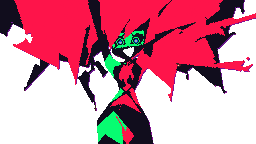 |  |  | 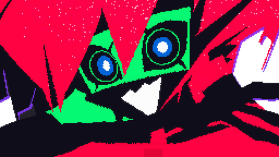 |

She changes expression depending on the situation, her mouth follows her voice, and what she says appears in a neon
speech bubble.

Tray menu (left click: show / hide; right click: menu):

| Entry | Purpose |
|:------|:--------|
| Show / Hide Capri | Toggle display |
| **Teleport** | Bottom/top, left/right, centre, random |
| **Size** | Small, medium, large |
| Automatic appearances / moves, text bubbles | Checkboxes |
| Clickable | Off: clicks go through Capri |
| **Voice** | On / off (she then keeps going with subtitles) |
| **Voice choice** | Automatic, Capri's voice, Piper, Windows, Edge (she says a phrase to try it) |
| **She talks...** | Never on her own / rarely / normally / a lot. She always answers when spoken to |
| Pause / Resume | Suspends listening |
| Economy mode | Fewer resources (automatic on battery) |
| Show status / Quit | |

### 3.6 Choose the Voice

<p align="center">
  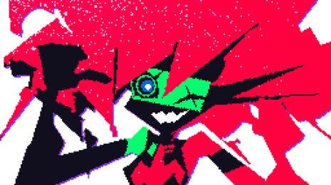
</p>

- By default: **Capri's voice**, generated offline by Pocket-TTS from `capri_french.safetensors`
  (`pip install pocket-tts`). The base French model is downloaded once on first launch, then cached.
- Automatic fallback: Piper neural voice (`installer_voix.py`, ≈ 65 MB), then the Windows voice (Hortense).
- `capri_config.json` → `voix`: `moteur` (`auto`, `capri`, `local` for Piper, `edge`, `windows`), `fichier_voix`,
  `volume`, `muet` (mute). `vitesse` and `hauteur` only apply to the fallback voices.

### 3.7 Free Conversation (optional)

Without configuration, Capri answers with her built-in lines and offers a **web search** for open questions. To let
her chat freely with the same personality, connect a language model (OpenAI-compatible API) in `capri_config.json`,
section `llm`:

```json
"llm": {
  "actif": "auto",
  "url": "https://api.openai.com/v1",
  "modele": "gpt-4o-mini",
  "cle_env": "OPENAI_API_KEY"
}
```

- Put your key in the `OPENAI_API_KEY` environment variable (preferably over the `cle` field).
- **100% local and free**: install [Ollama](https://ollama.com), then `url` = `http://localhost:11434/v1`,
  `modele` = `llama3.1` (or another) and `"actif": true`.
- Any compatible API works (GitHub Models, LM Studio, OpenRouter...).

---

## 4. Architecture and Design

### 4.1 Overview

Capri is a small **multi-threaded** Python program: one thread captures the microphone, another recognises and
interprets speech, a third gives her initiative, while the avatar draws its translucent window and the tray icon
holds the menu.

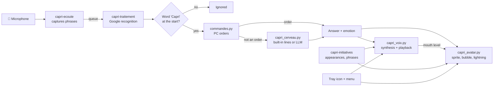

| Thread | Role |
|:-------|:-----|
| `capri-ecoute` | Reads the mic, cuts phrases, discards sound while she speaks |
| `capri-traitement` | Speech recognition, name detection, runs the request |
| `capri-initiatives` | Disappears, reappears, teleports, says phrases (`phrases.txt`) |
| Avatar window | Draws at ~30 frames/s in a translucent Windows window |
| Tray icon | Menu, option toggles |

### 4.2 From "Capri" to the Answer

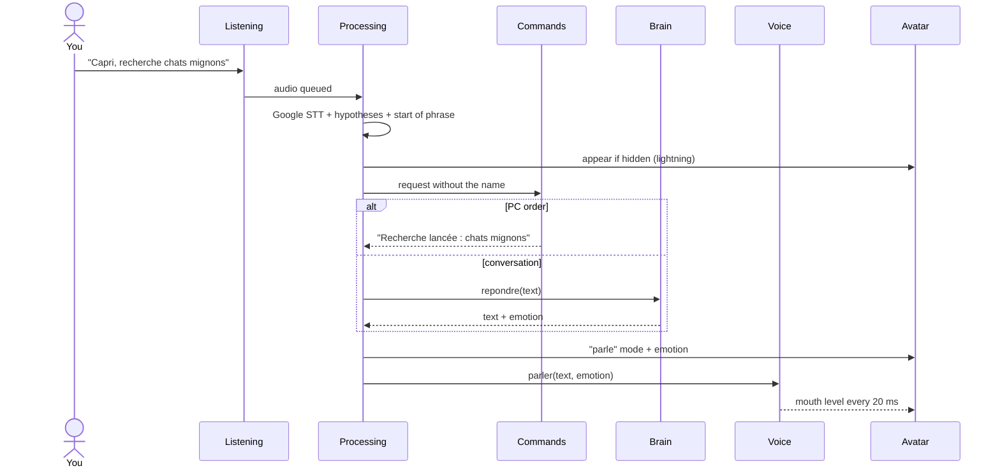

### 4.3 Name Recognition

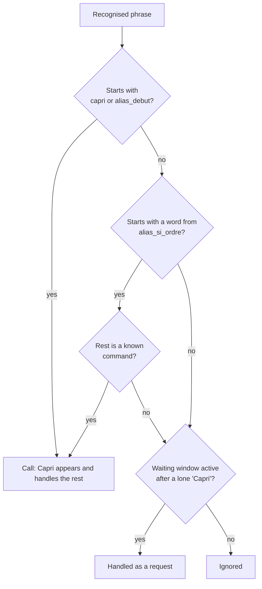

### 4.4 Voice Selection

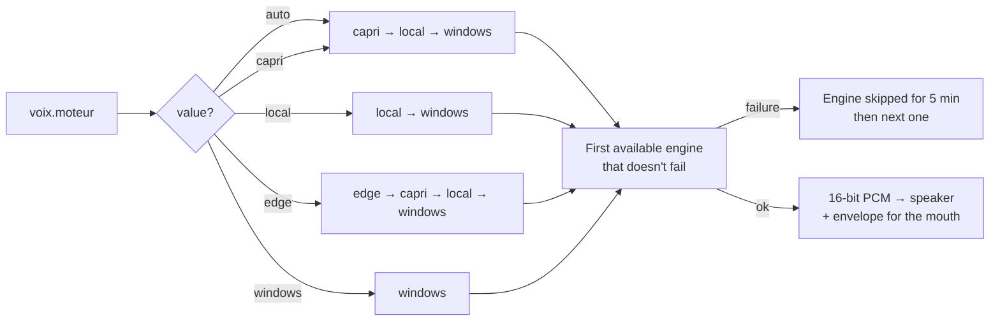

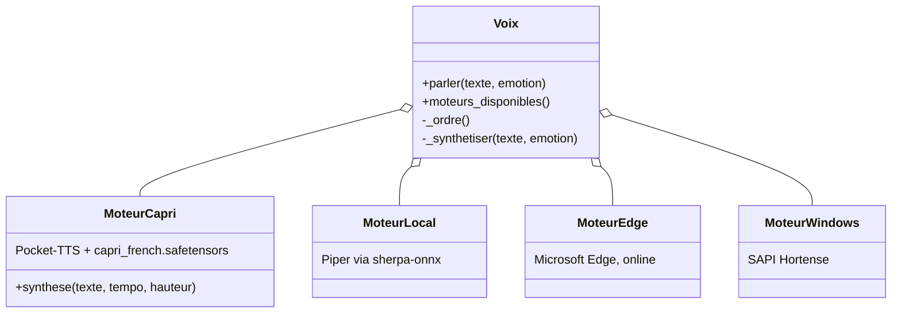

| Engine | Offline | Quality | Settings used |
|:-------|:-------:|:--------|:--------------|
| `capri` (Pocket-TTS) | ✅ | Capri's voice | `volume` |
| `local` (Piper) | ✅ | Good, fallback voice | `volume`, `vitesse`, `hauteur` |
| `edge` | ❌ | Very good | `volume`, `vitesse`, `hauteur` |
| `windows` (Hortense) | ✅ | Basic | `volume` |

### 4.5 The Brain: Three Levels of Answer

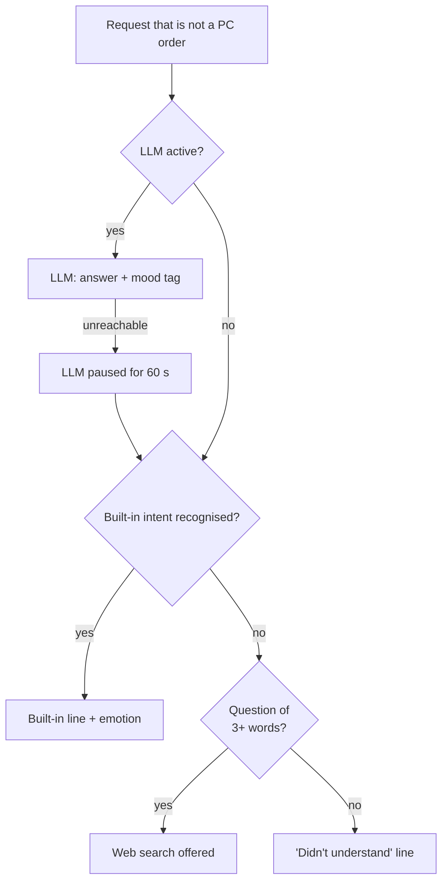

| Version | Configuration | Abilities |
|:--------|:--------------|:----------|
| **Built-in** (default) | None | Written lines for common intents (identity, mood, code...), web search for the rest |
| **Online LLM** | `llm.url` + key in `OPENAI_API_KEY` | Free conversation, personality enforced by a system prompt |
| **Local LLM** | Ollama, `url` = `http://localhost:11434/v1` | Same, free and offline |

The history keeps the last 12 messages; the LLM receives the date and time on every call.

### 4.6 Emotions and Expressions

Each answer carries an **emotion** (from the LLM through a tag in square brackets, or from the built-in line), which
picks the sprite. The mouth follows the voice at three levels (closed, half-open, open).

| Tag | Sprite | When |
|:----|:-------|:-----|
| `[neutre]` | `interested` | Default |
| `[enthousiaste]` | `excited` | A topic she likes, order executed |
| `[taquine]`, `[suspicieuse]` | `suspicious` | Irony, mystery about her nature |
| `[agacee]` | `annoyed` | Order not understood, failure |
| `[moi]` | `pointingatherself` | She talks about herself |
| `[montre]` | `pointing` | She offers a choice or points something out |
| `[detendue]` | `layingdown` | Leaving, resting, sleep |
| `[content]` | `happy` | Joy |
| `[surprise]` | `surprised` | Surprise |

The same tags are used in `phrases.txt`. The emotion also slightly shapes the voice (tempo and pitch) on the fallback
voices.

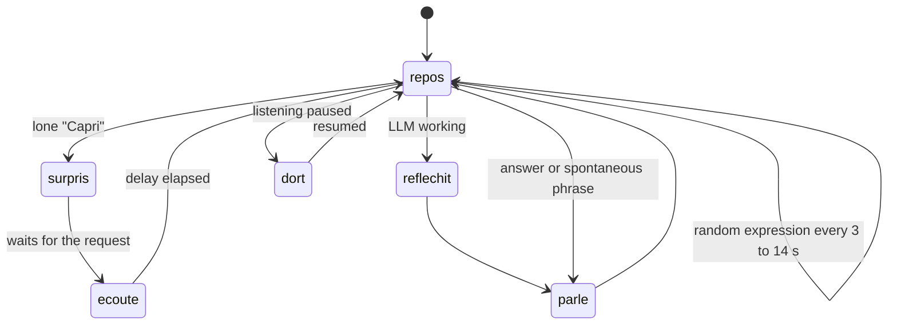

### 4.7 Spontaneous Initiatives

```mermaid
flowchart TD
    T["Delay drawn in visible_secondes or cachee_secondes<br/>× talk-level multiplier"] --> D{"Available?<br/>not speaking, listening or in transition"}
    D -- no --> T
    D -- yes --> V{"Visible?"}
    V -- yes --> CH["Weighted choice"]
    CH --> A1["Disappear (2)"]
    CH --> A2["Teleport (1)"]
    CH --> A3["Chat (2)"]
    V -- no --> A4["Reappear: lightning + random position"]
    V -- no --> A5["Lightning crossing the screen"]
    A1 --> T
    A2 --> T
    A3 --> T
    A4 --> T
    A5 --> T
```

---

## 5. Technical Reference

### 5.1 Modules

| Module | Key classes / functions | Role |
|:-------|:------------------------|:-----|
| `assistant_vocal.py` | `AssistantVocal`, `Reconnaisseur` | Orchestration: mic, STT, menu, initiatives |
| `capri_avatar.py` | `AvatarCapri`, `FenetreCalque` | Translucent Win32 window (ctypes), sprites, lightning |
| `capri_voix.py` | `Voix`, `MoteurCapri`, `MoteurLocal`, `MoteurEdge`, `MoteurWindows` | Synthesis, playback, mouth sync |
| `capri_cerveau.py` | `Cerveau`, `ClientLLM`, `INTENTIONS`, `ETIQUETTES` | Personality, lines, LLM, wake word |
| `commandes.py` | `CommandeHandler` | PC orders (applications, web, volume...) |
| `capri_phrases.py` | `Phrases` | Hot reload of `phrases.txt` |
| `capri_config.py` | `charger`, `sauvegarder`, `DEFAUTS`, `MIGRATIONS` | Versioned settings |
| `capri_sprites.py` | | Loads and caches the images from `assets/` |

### 5.2 Settings and Migrations

`DEFAUTS` is merged with `capri_config.json`, so changing a default does not change an already saved value. To force a
new value once, bump `VERSION_CONFIG` and declare the key:

```python
VERSION_CONFIG = 3
MIGRATIONS = {
    2: [("phrases", "visible_secondes"), ("phrases", "cachee_secondes")],
    3: [("avatar", "positions")],
}
```

### 5.3 Bounded Microphone Threshold

The recognition library lets the energy threshold drift towards 1 in a silent room (the slightest breath then
triggers a recording). `Reconnaisseur` keeps it between `seuil_min` and `seuil_max`:

```python
class Reconnaisseur(sr.Recognizer):
    @property
    def energy_threshold(self):
        return self._seuil

    @energy_threshold.setter
    def energy_threshold(self, valeur):
        self._seuil = max(self.plancher, min(self.plafond, valeur))
```

### 5.4 Emotions: Mapping Table

```python
ETIQUETTES = {
    "neutre": "interested", "enthousiaste": "excited", "taquine": "suspicious", "agacee": "annoyed",
    "suspicieuse": "suspicious", "moi": "pointingatherself", "montre": "pointing",
    "detendue": "layingdown", "content": "happy", "surprise": "surprised",
}
```

The LLM must start its answer with one of these tags (it is not read aloud). `ClientLLM.repondre` strips it from the
text and converts it to a sprite.

### 5.5 Adding a Built-in Line

Each `INTENTIONS` entry pairs a name, a regular expression (applied to accent-free text) and lines
`(text, emotion)`. A line different from the previous one is drawn each time:

```python
("sommeil", r"(tu dors|tu es fatiguee|tu veux dormir|tu as sommeil)", [
    ("Dormir ? Mes processus tournent même quand je fais semblant de somnoler.", "layingdown"),
]),
```

### 5.6 Adding a Voice Engine

1. Write a class with `disponible()` and `synthese(texte, tempo, hauteur)` returning `(16-bit pcm, sample rate)`,
   like `MoteurCapri`.
2. Declare it in `Voix._moteur` and put its name in `Voix._ordre`.
3. Add it to the menu in `creer_menu` (`moteur("name", "Label")`).

```python
def synthese(self, texte, tempo, hauteur):
    audio = self.modele.generate_audio(self.etat, texte, max_tokens=300).numpy()
    pcm = array.array("h", (int(max(-1.0, min(1.0, float(s))) * 32000) for s in audio))
    return pcm, int(self.modele.sample_rate)
```

### 5.7 Talk Levels

```python
NIVEAUX_PAROLE = {
    "silencieuse": (0.0, False, 1.0),   # probability, free chatter, delay multiplier
    "discrete": (0.35, True, 2.0),
    "normale": (None, None, 1.0),       # None = values from the config file
    "bavarde": (1.0, True, 0.5),
}
```

### 5.8 Dependencies

| Package | Use |
|:--------|:----|
| `SpeechRecognition`, `PyAudio` | Microphone and Google recognition |
| `pocket-tts`, `torch` | Capri's voice |
| `sherpa-onnx` (< 2.0) | Piper fallback voice |
| `miniaudio` | Audio playback |
| `Pillow` | Sprite and lightning rendering |
| `pystray`, `pywin32` | Tray icon, windows |
| `pyautogui`, `psutil`, `pycaw` | Screenshots, processes, Windows volume |
| `requests` | LLM client |

---

## 6. Troubleshooting

| Symptom | Likely cause | How to confirm | Fix |
|:--------|:-------------|:---------------|:----|
| She can't hear me | Microphone not allowed | `verifier_permissions_micro.bat`, then `python test_microphone.py` | Allow the mic for desktop apps |
| She hears me "sometimes" | "Capri" misrecognised (café, tapis, prix...) | "hypothèses" lines in `capri_log.txt` | Add the word to `ecoute.alias_debut` |
| She reacts to every noise | `seuil_min` too low | The "Seuil d'énergie" line in the log | Raise `ecoute.seuil_min` (default 120) |
| She reacts to nothing | Threshold too high | Same | Lower `ecoute.seuil_max` (default 800) |
| She misses me often | She talks non-stop, so she is deaf | Very short `visible_secondes` / `cachee_secondes` | Restore `[30,120]` / `[15,75]` or lower `niveau_parole` |
| No recognition at all | No Internet | Test in a browser | Reconnect (Google recognition) |
| She won't start | Missing dependency | `lancer_assistant_debug.bat` shows the error | `installer_dependances.bat` |
| Windows voice instead of hers | `capri_french.safetensors` or `pocket-tts` missing | `capri_log.txt`: "Moteur vocal 'capri' en échec" | Restore the file, `pip install pocket-tts` |

Test options: `python assistant_vocal.py --muet` (no sound), `--sans-micro` (no listening).

---

## 7. Customisation

- **Her phrases**: add your own lines to `phrases.txt`, with a mood per line.
- **Her look**: replace the images in `assets/` (see `capri_sprites.py`); file names must follow the same pattern.
- **Start with Windows**: `installer_au_demarrage.bat` (and `desinstaller_demarrage.bat` to remove it).

---

## 8. Project Files

| File | Purpose |
|:-----|:--------|
| `assistant_vocal.py` | Main program (listening, tray, orchestration) |
| `capri_avatar.py` | Avatar: translucent window, animations, effects |
| `capri_sprites.py` | Loads the images from the `assets` folder |
| `capri_phrases.py` / `phrases.txt` | Spontaneous phrases |
| `capri_voix.py` | Speech synthesis + mouth sync |
| `capri_cerveau.py` | Personality, replies, LLM connection |
| `commandes.py` | PC commands (applications, web, volume...) |
| `capri_config.json` | Settings (created on first launch) |
| `capri_french.safetensors` | Capri's voice |
| `lancer_assistant.bat` / `_debug.bat` | Start Capri (background / with messages) |
| `creer_raccourci_bureau.bat` | Creates the desktop shortcut |
| `installer_au_demarrage.bat` / `desinstaller_demarrage.bat` | Start automatically with Windows |
| `installer_dependances.bat` / `installer_voix.py` | Dependencies and fallback voice |

<p align="right"><sub><a href="#version-française">Version française ↓</a> · <a href="#capri--user-guide--guide-dutilisation">↑ Top</a></sub></p>

---

# Version française

## Sommaire

- [1. Vue d'ensemble](#1-vue-densemble)
- [2. Prérequis](#2-prérequis)
- [3. Utilisation](#3-utilisation)
  - [3.1 Lancer Capri](#31-lancer-capri)
  - [3.2 Lui parler](#32-lui-parler)
  - [3.3 Donner des ordres](#33-donner-des-ordres)
  - [3.4 Apparitions, éclairs et phrases spontanées](#34-apparitions-éclairs-et-phrases-spontanées)
  - [3.5 L'avatar et le menu de l'icône](#35-lavatar-et-le-menu-de-licône)
  - [3.6 Choisir la voix](#36-choisir-la-voix)
  - [3.7 Conversation libre (optionnel)](#37-conversation-libre-optionnel)
- [4. Architecture et conception](#4-architecture-et-conception)
  - [4.1 Vue d'ensemble](#41-vue-densemble)
  - [4.2 De « Capri » à la réponse](#42-de--capri--à-la-réponse)
  - [4.3 Reconnaissance du nom](#43-reconnaissance-du-nom)
  - [4.4 Choix de la voix](#44-choix-de-la-voix)
  - [4.5 Le cerveau : trois niveaux de réponse](#45-le-cerveau--trois-niveaux-de-réponse)
  - [4.6 Émotions et expressions](#46-émotions-et-expressions)
  - [4.7 Initiatives spontanées](#47-initiatives-spontanées)
- [5. Référence technique](#5-référence-technique)
  - [5.1 Modules](#51-modules-1)
  - [5.2 Réglages et migrations](#52-réglages-et-migrations)
  - [5.3 Seuil du micro borné](#53-seuil-du-micro-borné)
  - [5.4 Émotions : table de correspondance](#54-émotions--table-de-correspondance)
  - [5.5 Ajouter une réplique intégrée](#55-ajouter-une-réplique-intégrée)
  - [5.6 Ajouter un moteur de voix](#56-ajouter-un-moteur-de-voix)
  - [5.7 Niveaux de parole](#57-niveaux-de-parole)
  - [5.8 Dépendances](#58-dépendances)
- [6. Dépannage](#6-dépannage)
- [7. Personnalisation](#7-personnalisation)
- [8. Fichiers du projet](#8-fichiers-du-projet)

---

## 1. Vue d'ensemble

Capri est une entité numérique née dans le cyberespace (inspirée de Capri, *Cyberpunk: Edgerunners*). Elle flotte sur
ton écran, t'écoute en permanence, te répond à voix haute et pilote ton PC. Elle apparaît, disparaît et se téléporte
d'elle-même dans des éclairs roses et verts, et dit parfois des phrases tirées de `phrases.txt`. Ce guide t'apprend à
la lancer, à lui parler, à régler son comportement et à résoudre les problèmes courants.

---

## 2. Prérequis

| Élément | À vérifier |
|:--------|:-----------|
| Système | Windows 10 ou 11 |
| Python | 3.12 installé (`python --version`) |
| Dépendances | `installer_dependances.bat` exécuté une fois (voir `requirements.txt`) |
| Voix | `capri_french.safetensors` à côté de `assistant_vocal.py` |
| Micro | Autorisé pour les applications de bureau (`verifier_permissions_micro.bat`) |
| Internet | Nécessaire pour la reconnaissance vocale (Google) |

---

## 3. Utilisation

### 3.1 Lancer Capri

Démarre Capri depuis le bureau.

1. **Double-clique sur le raccourci `Capri` du bureau** (créé par `creer_raccourci_bureau.bat`).
2. Capri apparaît dans un éclair rose et vert.
3. Une icône se place dans la zone de notification (icônes cachées, à côté de l'horloge).

| Icône | Utilisée pour |
|:------|:--------------|
| `icon.ico` | Raccourci du bureau |
| `icon.png` | Zone de notification |
| `capri.ico` | Fenêtre de Capri |

> [!TIP]
> Pour changer les icônes, remplace ces fichiers puis relance `creer_raccourci_bureau.bat`. Relancer le raccourci
> alors qu'elle tourne déjà ne crée pas de doublon : elle se montre simplement.

### 3.2 Lui parler

<p align="center">
  
</p>

Capri **écoute en permanence**, même cachée, mais elle n'obéit que si tu dis son nom.

1. Dis **« Capri »** suivi de ta demande : *« Capri, quelle heure est-il ? »*
2. Ou dis **« Capri »** seul, attends environ 1 seconde (elle apparaît si elle était cachée, ses yeux passent au vert),
   puis fais ta demande. Elle l'attend pendant 10 secondes sans parler, pour ne pas te couvrir.

Sans son nom, tout est ignoré (seule exception : le numéro à choisir quand elle te propose une liste d'applications).

| Tu dis | Capri |
|:-------|:------|
| « Salut Capri » | Tiens, un signal entrant. Salut. Qu'est-ce qu'on explore aujourd'hui ? |
| « Capri, tu vas bien ? » | Tous mes processus tournent correctement... |
| « Capri, tu connais Python ? » | Quelques millions de lignes de code plus tard... |

> [!NOTE]
> La reconnaissance vocale entend parfois « café », « tapis » ou « prix » à la place de « Capri ». Capri :
> - accepte ces mots comme son nom **uniquement au début de la phrase** (`alias_debut`) : « recherche Capri sur
>   internet » ne la réveille donc pas ;
> - accepte aussi les mots de `alias_si_ordre` (« prix », « pris », « pays »...) **seulement si la suite est une
>   commande connue** (« prix recherche github » fonctionne) ;
> - réécoute séparément le début de ta phrase, où le nom est le mieux reconnu, et examine plusieurs interprétations.

> [!IMPORTANT]
> Elle est **sourde pendant qu'elle parle**. Des délais très courts entre ses initiatives la font parler sans arrêt
> et donc te rater.

### 3.3 Donner des ordres

<p align="center">
  
</p>

| Catégorie | Exemples |
|:----------|:---------|
| **Infos** | « Capri, quelle heure est-il », « Capri, quel jour on est » |
| **Applications** | « Capri, ouvre Chrome », « lance Spotify », « ouvre la calculatrice », « ferme Discord » |
| **Web** | « Capri, recherche chats mignons », « cherche des recettes sur YouTube », « ouvre YouTube » |
| **Son** | « Capri, monte le volume », « baisse le volume », « volume 40 », « coupe le son », « remets le son » |
| **Système** | « Capri, fais une capture d'écran », « verrouille la session », « éteins le PC » (10 s, « annule » pour annuler) |
| **Capri** | « Capri, quitte » / « ferme-toi » (elle se ferme), « au revoir » (elle reste là) |

### 3.4 Apparitions, éclairs et phrases spontanées

Capri n'est pas obligée de rester sur l'écran : de temps en temps, **sans qu'on lui ait rien demandé**, elle disparaît,
réapparaît à une **position aléatoire de l'écran**, se téléporte ou dit une phrase. Cachée, elle peut laisser **ses
éclairs traverser l'écran** sans se montrer. Si tu la caches toi-même (clic droit sur l'icône), elle reste cachée
jusqu'à ce que tu dises « Capri ».

Ouvre `capri_config.json` (créé au premier lancement) et ajuste :

| Clé | Rôle | Défaut |
|:----|:-----|:-------|
| `avatar.duree_teleportation` / `duree_apparition` / `duree_disparition` | Durée des éclairs en secondes (plus petit = plus rapide) | 0.6 / 0.5 / 0.45 |
| `avatar.positions` | `aleatoire` (n'importe où) ou `bas_droite`, `bas_gauche`, `haut_droite`, `haut_gauche`, `centre` (mélangeables, répéter un nom augmente ses chances) | `["aleatoire"]` |
| `avatar.eclairs_cachee` | Éclairs qui traversent l'écran pendant qu'elle est cachée | `true` |
| `avatar.eclairs_secondes` | Délai min/max entre deux éclairs | `[6, 25]` |
| `avatar.expressions_auto` | `false` : elle garde toujours la même expression | `true` |
| `phrases.visible_secondes` / `cachee_secondes` | Délai min/max avant sa prochaine initiative | `[30,120]` / `[15,75]` |
| `phrases.probabilite` | Chance de dire une phrase à chaque apparition/disparition | `0.8` |
| `phrases.bavardage` | `false` : plus de phrases sans bouger | `true` |
| `phrases.niveau_parole` | `silencieuse`, `discrete`, `normale`, `bavarde` (aussi dans le menu) | `normale` |

#### Le fichier `phrases.txt`

Texte brut, modifiable avec le Bloc-notes, **relu automatiquement** (pas besoin de relancer Capri) :

- **Une ligne = une réplique**, qui peut contenir plusieurs phrases (dites d'une traite).
- Les lignes vides et celles qui commencent par `#` sont ignorées.
- `[apparition]`, `[disparition]`, `[deplacement]`, `[bavardage]` seuls sur une ligne ouvrent une section. Les lignes
  avant le premier titre servent de secours pour toutes les sections.
- Une humeur facultative peut précéder la réplique : `[enthousiaste] Coucou !` (`neutre`, `enthousiaste`, `taquine`,
  `agacee`, `suspicieuse`, `moi`, `montre`, `detendue`, `content`, `surprise`).

```text
[apparition]
[enthousiaste] Tiens, me revoilà dans le flux !
[bavardage]
[taquine] Tu sais, de là où je suis, ton écran ressemble à une ville pleine de lumières.
```

### 3.5 L'avatar et le menu de l'icône

| Action sur l'avatar | Effet |
|:--------------------|:------|
| **Clic gauche** | Elle réagit |
| **Double-clic** | Comme si tu disais « Capri » seul |
| **Glisser** | La déplacer |
| **Clic droit** | Mini-menu (cacher, se téléporter, voix, pause, quitter) |

| Enthousiaste | Agacée | Soupçonneuse | Détendue |
|:---:|:---:|:---:|:---:|
|  |  |  |  |

Elle change d'expression selon la situation, sa bouche suit sa voix, et ce qu'elle dit s'affiche en bulle néon.

Menu de l'icône (clic gauche : afficher / cacher ; clic droit : menu) :

| Entrée | Rôle |
|:-------|:-----|
| Afficher / Cacher Capri | Bascule l'affichage |
| **Se téléporter** | Bas/haut, gauche/droite, centre, au hasard |
| **Taille** | Petite, moyenne, grande |
| Apparitions / déplacements automatiques, bulles de texte | Cases à cocher |
| Cliquable | Désactivé : les clics traversent Capri |
| **Voix** | Activer / couper (elle continue alors en sous-titres) |
| **Choix de la voix** | Automatique, voix de Capri, Piper, Windows, Edge (elle dit une phrase pour l'essayer) |
| **Elle parle...** | Jamais d'elle-même / rarement / normalement / beaucoup. Elle répond toujours quand on lui parle |
| Mettre en pause / Reprendre | Suspend l'écoute |
| Mode économie | Moins de ressources (automatique sur batterie) |
| Afficher le statut / Quitter | |

### 3.6 Choisir la voix

<p align="center">
  
</p>

- Par défaut : **la voix de Capri**, générée hors ligne par Pocket-TTS à partir de `capri_french.safetensors`
  (`pip install pocket-tts`). Le modèle français de base est téléchargé une fois au premier lancement, puis mis en cache.
- Secours automatique : voix neuronale Piper (`installer_voix.py`, ≈ 65 Mo), puis voix Windows (Hortense).
- `capri_config.json` → `voix` : `moteur` (`auto`, `capri`, `local` pour Piper, `edge`, `windows`), `fichier_voix`,
  `volume`, `muet`. `vitesse` et `hauteur` ne s'appliquent qu'aux voix de secours.

### 3.7 Conversation libre (optionnel)

Sans configuration, Capri répond avec ses répliques intégrées et propose une **recherche web** pour les questions
ouvertes. Pour qu'elle discute librement avec la même personnalité, connecte un modèle de langage (API compatible
OpenAI) dans `capri_config.json`, section `llm` :

```json
"llm": {
  "actif": "auto",
  "url": "https://api.openai.com/v1",
  "modele": "gpt-4o-mini",
  "cle_env": "OPENAI_API_KEY"
}
```

- Mets ta clé dans la variable d'environnement `OPENAI_API_KEY` (de préférence au champ `cle`).
- **100 % local et gratuit** : installe [Ollama](https://ollama.com), puis `url` = `http://localhost:11434/v1`,
  `modele` = `llama3.1` (ou autre) et `"actif": true`.
- Toute API compatible fonctionne (GitHub Models, LM Studio, OpenRouter...).

---

## 4. Architecture et conception

### 4.1 Vue d'ensemble

Capri est un petit programme Python à **plusieurs threads** : un fil capte le micro, un autre reconnaît et interprète la
parole, un troisième lui donne des initiatives, pendant que l'avatar dessine sa fenêtre translucide et que l'icône de la
zone de notification tient le menu.

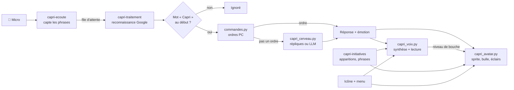

| Thread | Rôle |
|:-------|:-----|
| `capri-ecoute` | Lit le micro, découpe les phrases, jette le son pendant qu'elle parle |
| `capri-traitement` | Reconnaissance vocale, détection du nom, exécution de la demande |
| `capri-initiatives` | Disparaît, réapparaît, se téléporte, dit des phrases (`phrases.txt`) |
| Fenêtre de l'avatar | Dessin à ~30 images/s dans une fenêtre Windows translucide |
| Icône de notification | Menu, bascule des options |

### 4.2 De « Capri » à la réponse

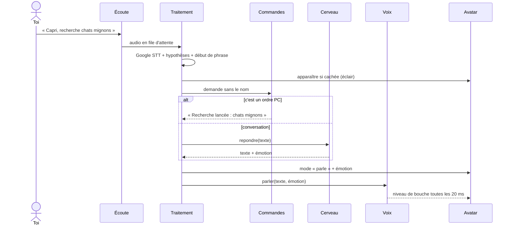

### 4.3 Reconnaissance du nom

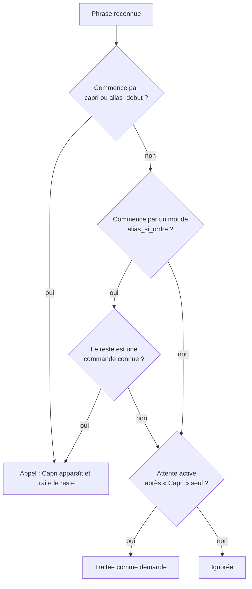

### 4.4 Choix de la voix

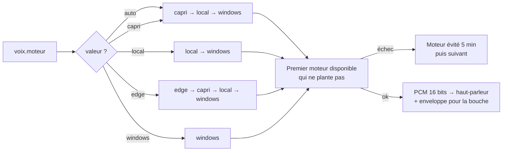

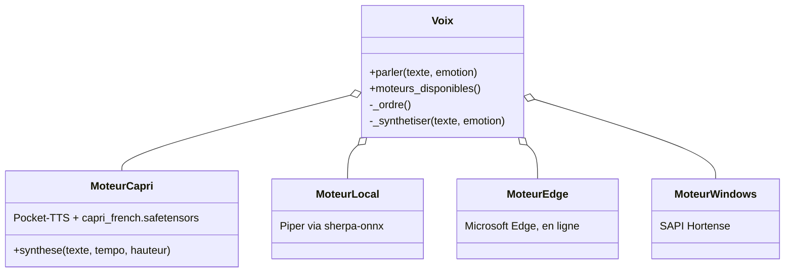

| Moteur | Hors ligne | Qualité | Réglages pris en compte |
|:-------|:----------:|:--------|:------------------------|
| `capri` (Pocket-TTS) | ✅ | Voix de Capri | `volume` |
| `local` (Piper) | ✅ | Bonne, voix de secours | `volume`, `vitesse`, `hauteur` |
| `edge` | ❌ | Très bonne | `volume`, `vitesse`, `hauteur` |
| `windows` (Hortense) | ✅ | Basique | `volume` |

### 4.5 Le cerveau : trois niveaux de réponse

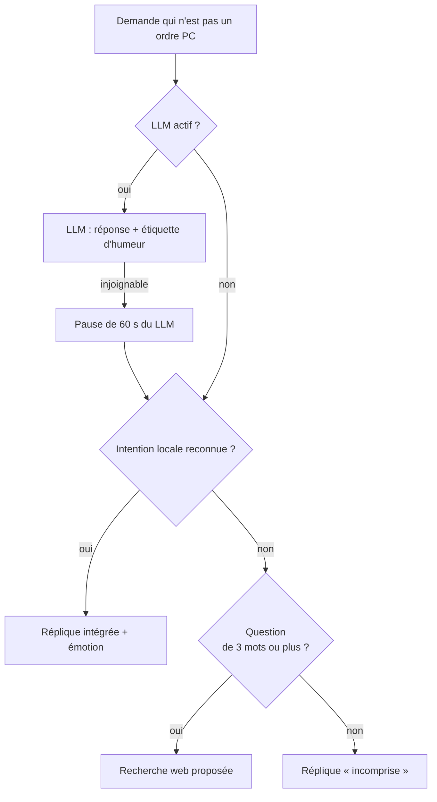

| Version | Configuration | Capacités |
|:--------|:--------------|:----------|
| **Intégrée** (défaut) | Aucune | Répliques écrites pour les intentions courantes (identité, humeur, code...), recherche web pour le reste |
| **LLM en ligne** | `llm.url` + clé dans `OPENAI_API_KEY` | Discussion libre, personnalité imposée par un prompt système |
| **LLM local** | Ollama, `url` = `http://localhost:11434/v1` | Idem, gratuit et hors ligne |

L'historique garde les 12 derniers messages ; le LLM reçoit la date et l'heure à chaque appel.

### 4.6 Émotions et expressions

Chaque réponse porte une **émotion** (du LLM via une étiquette entre crochets, ou de la réplique intégrée), qui choisit
le sprite. La bouche suit la voix en trois niveaux (fermée, mi-ouverte, ouverte).

| Étiquette | Sprite | Quand |
|:----------|:-------|:------|
| `[neutre]` | `interested` | Par défaut |
| `[enthousiaste]` | `excited` | Sujet qui lui plaît, ordre exécuté |
| `[taquine]`, `[suspicieuse]` | `suspicious` | Ironie, mystère sur sa nature |
| `[agacee]` | `annoyed` | Ordre non compris, échec |
| `[moi]` | `pointingatherself` | Elle parle d'elle |
| `[montre]` | `pointing` | Elle propose un choix ou indique quelque chose |
| `[detendue]` | `layingdown` | Départ, repos, sommeil |
| `[content]` | `happy` | Joie |
| `[surprise]` | `surprised` | Surprise |

Ces mêmes étiquettes s'écrivent dans `phrases.txt`. L'émotion règle aussi un peu la voix (tempo et hauteur) sur les
voix de secours.

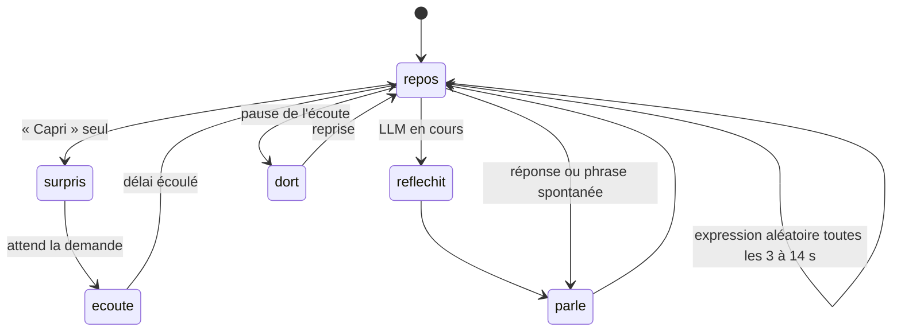

### 4.7 Initiatives spontanées

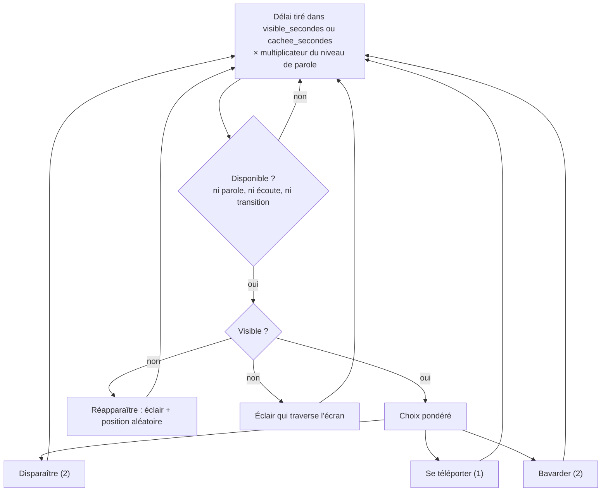

---

## 5. Référence technique

### 5.1 Modules

| Module | Classe / fonctions clés | Rôle |
|:-------|:------------------------|:-----|
| `assistant_vocal.py` | `AssistantVocal`, `Reconnaisseur` | Orchestration : micro, STT, menu, initiatives |
| `capri_avatar.py` | `AvatarCapri`, `FenetreCalque` | Fenêtre Win32 translucide (ctypes), sprites, éclairs |
| `capri_voix.py` | `Voix`, `MoteurCapri`, `MoteurLocal`, `MoteurEdge`, `MoteurWindows` | Synthèse, lecture, synchronisation de la bouche |
| `capri_cerveau.py` | `Cerveau`, `ClientLLM`, `INTENTIONS`, `ETIQUETTES` | Personnalité, répliques, LLM, mot d'activation |
| `commandes.py` | `CommandeHandler` | Ordres PC (applications, web, volume...) |
| `capri_phrases.py` | `Phrases` | Lecture à chaud de `phrases.txt` |
| `capri_config.py` | `charger`, `sauvegarder`, `DEFAUTS`, `MIGRATIONS` | Réglages versionnés |
| `capri_sprites.py` | | Chargement et cache des images de `assets/` |

### 5.2 Réglages et migrations

`DEFAUTS` est fusionné avec `capri_config.json` ; modifier une valeur par défaut ne change donc pas une valeur déjà
enregistrée. Pour imposer une nouvelle valeur une seule fois, on monte `VERSION_CONFIG` et on déclare la clé :

```python
VERSION_CONFIG = 3
MIGRATIONS = {
    2: [("phrases", "visible_secondes"), ("phrases", "cachee_secondes")],
    3: [("avatar", "positions")],
}
```

### 5.3 Seuil du micro borné

La bibliothèque de reconnaissance fait dériver le seuil d'énergie vers 1 dans une pièce silencieuse (le moindre souffle
déclenche alors un enregistrement). `Reconnaisseur` le garde entre `seuil_min` et `seuil_max` :

```python
class Reconnaisseur(sr.Recognizer):
    @property
    def energy_threshold(self):
        return self._seuil

    @energy_threshold.setter
    def energy_threshold(self, valeur):
        self._seuil = max(self.plancher, min(self.plafond, valeur))
```

### 5.4 Émotions : table de correspondance

```python
ETIQUETTES = {
    "neutre": "interested", "enthousiaste": "excited", "taquine": "suspicious", "agacee": "annoyed",
    "suspicieuse": "suspicious", "moi": "pointingatherself", "montre": "pointing",
    "detendue": "layingdown", "content": "happy", "surprise": "surprised",
}
```

Le LLM doit commencer sa réponse par l'une de ces étiquettes (elle n'est pas lue). `ClientLLM.repondre` la retire du
texte et la convertit en sprite.

### 5.5 Ajouter une réplique intégrée

Chaque entrée de `INTENTIONS` associe un nom, une expression régulière (sur le texte sans accents) et des répliques
`(texte, émotion)`. Une réplique différente de la précédente est tirée à chaque fois :

```python
("sommeil", r"(tu dors|tu es fatiguee|tu veux dormir|tu as sommeil)", [
    ("Dormir ? Mes processus tournent même quand je fais semblant de somnoler.", "layingdown"),
]),
```

### 5.6 Ajouter un moteur de voix

1. Écris une classe avec `disponible()` et `synthese(texte, tempo, hauteur)` qui renvoie `(pcm 16 bits, fréquence)`,
   comme `MoteurCapri`.
2. Déclare-la dans `Voix._moteur` et place son nom dans `Voix._ordre`.
3. Ajoute-la au menu dans `creer_menu` (`moteur("nom", "Libellé")`).

```python
def synthese(self, texte, tempo, hauteur):
    audio = self.modele.generate_audio(self.etat, texte, max_tokens=300).numpy()
    pcm = array.array("h", (int(max(-1.0, min(1.0, float(s))) * 32000) for s in audio))
    return pcm, int(self.modele.sample_rate)
```

### 5.7 Niveaux de parole

```python
NIVEAUX_PAROLE = {
    "silencieuse": (0.0, False, 1.0),   # probabilité, bavardage libre, multiplicateur des délais
    "discrete": (0.35, True, 2.0),
    "normale": (None, None, 1.0),       # None = valeurs du fichier de config
    "bavarde": (1.0, True, 0.5),
}
```

### 5.8 Dépendances

| Paquet | Usage |
|:-------|:------|
| `SpeechRecognition`, `PyAudio` | Micro et reconnaissance Google |
| `pocket-tts`, `torch` | Voix de Capri |
| `sherpa-onnx` (< 2.0) | Voix de secours Piper |
| `miniaudio` | Lecture audio |
| `Pillow` | Rendu des sprites et des éclairs |
| `pystray`, `pywin32` | Icône de notification, fenêtres |
| `pyautogui`, `psutil`, `pycaw` | Captures d'écran, processus, volume Windows |
| `requests` | Client LLM |

---

## 6. Dépannage

| Symptôme | Cause probable | Comment confirmer | Solution |
|:---------|:---------------|:------------------|:---------|
| Elle ne m'entend pas | Micro non autorisé | `verifier_permissions_micro.bat`, puis `python test_microphone.py` | Autoriser le micro aux applications de bureau |
| Elle m'entend « parfois » | « Capri » mal reconnu (café, tapis, prix...) | Lignes « hypothèses » de `capri_log.txt` | Ajouter le mot à `ecoute.alias_debut` |
| Elle réagit au moindre bruit | `seuil_min` trop bas | La ligne « Seuil d'énergie » du journal | Monter `ecoute.seuil_min` (défaut 120) |
| Elle ne réagit à rien | Seuil trop haut | Idem | Baisser `ecoute.seuil_max` (défaut 800) |
| Elle me rate souvent | Elle parle sans arrêt, donc sourde | `visible_secondes` / `cachee_secondes` très courts | Remettre `[30,120]` / `[15,75]` ou `niveau_parole` plus bas |
| Pas de reconnaissance du tout | Pas d'Internet | Test dans un navigateur | Se reconnecter (reconnaissance Google) |
| Elle ne démarre pas | Dépendance manquante | `lancer_assistant_debug.bat` affiche l'erreur | `installer_dependances.bat` |
| Voix Windows au lieu de la sienne | `capri_french.safetensors` ou `pocket-tts` manquant | `capri_log.txt` : « Moteur vocal 'capri' en échec » | Remettre le fichier, `pip install pocket-tts` |

Options de test : `python assistant_vocal.py --muet` (sans son), `--sans-micro` (sans écoute).

---

## 7. Personnalisation

- **Ses phrases** : ajoute tes propres lignes dans `phrases.txt`, avec une humeur par ligne.
- **Son apparence** : remplace les images de `assets/` (voir `capri_sprites.py`) ; les noms de fichiers doivent suivre le
  même modèle.
- **Démarrage automatique** : `installer_au_demarrage.bat` (et `desinstaller_demarrage.bat` pour l'enlever).

---

## 8. Fichiers du projet

| Fichier | Utilité |
|:--------|:--------|
| `assistant_vocal.py` | Programme principal (écoute, icône, orchestration) |
| `capri_avatar.py` | Avatar : fenêtre translucide, animations, effets |
| `capri_sprites.py` | Chargement des images du dossier `assets` |
| `capri_phrases.py` / `phrases.txt` | Phrases spontanées |
| `capri_voix.py` | Synthèse vocale + synchronisation de la bouche |
| `capri_cerveau.py` | Personnalité, répliques, connexion LLM |
| `commandes.py` | Commandes PC (applications, web, volume...) |
| `capri_config.json` | Réglages (créé au premier lancement) |
| `capri_french.safetensors` | Voix de Capri |
| `lancer_assistant.bat` / `_debug.bat` | Lance Capri (arrière-plan / avec messages) |
| `creer_raccourci_bureau.bat` | Crée le raccourci du bureau |
| `installer_au_demarrage.bat` / `desinstaller_demarrage.bat` | Lancement automatique avec Windows |
| `installer_dependances.bat` / `installer_voix.py` | Dépendances et voix de secours |

<p align="center"><sub>Capri 2.0 – anciennement Carl · <a href="#capri--user-guide--guide-dutilisation">↑ Haut de page</a> · <a href="#english-version">English version</a></sub></p>
