# Capri – User Guide

| Language | Version |
|:---------|:--------|
| 🇫🇷 Français | **[GUIDE_UTILISATION.md](GUIDE_UTILISATION.md)** |
| 🇬🇧 English | **[USER_GUIDE.md](USER_GUIDE.md)** (this page) |

<p align="center">
  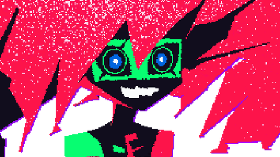
</p>

## 1. Overview

Capri is a digital entity born in cyberspace (inspired by Capri from *Cyberpunk: Edgerunners*). She floats on your
screen, listens all the time, answers out loud and controls your PC. She appears, disappears and teleports on her own
in pink and green lightning, and sometimes says phrases taken from `phrases.txt`. This guide shows you how to launch
her, talk to her, tune her behaviour and fix common problems.

> [!NOTE]
> Capri listens and speaks **French**. Voice commands are given in French, with a translation where useful.

---

## 2. What You Will Learn

| Skill | You can... |
|:------|:-----------|
| Launch Capri | Start from the desktop shortcut and find her tray icon |
| Talk to her | Call her by name, with or without a request, even when she is hidden |
| Give orders | Open apps, search the web, change the volume, lock the PC |
| Tune her behaviour | Choose her positions, lightning speed and how much she talks |
| Customise | Edit her phrases, change her voice and connect a language model |
| Troubleshoot | Diagnose flaky listening or a failed start |

---

## 3. Before You Start

| Item | Check |
|:-----|:------|
| System | Windows 10 or 11 |
| Python | 3.12 installed (`python --version`) |
| Dependencies | `installer_dependances.bat` run once (see `requirements.txt`) |
| Voice | `capri_french.safetensors` next to `assistant_vocal.py` |
| Microphone | Allowed for desktop apps (`verifier_permissions_micro.bat`) |
| Internet | Required for speech recognition (Google) |

---

## 4. Steps

### Step 1 - Launch Capri

Start Capri from the desktop. (1 min)

1. **Double-click the `Capri` shortcut on the desktop** (created by `creer_raccourci_bureau.bat`).
2. Capri appears in a pink and green lightning flash.
3. An icon is placed in the notification area (hidden icons, next to the clock).

| Icon | Used for |
|:-----|:---------|
| `icon.ico` | Desktop shortcut |
| `icon.png` | Notification area |
| `capri.ico` | Capri's window |

> [!TIP]
> To change the icons, replace these files and run `creer_raccourci_bureau.bat` again. Launching the shortcut while
> she is already running does not create a duplicate: she simply shows herself.

**Checkpoint:** Capri is visible on screen and her icon is in the notification area.

### Step 2 - Talk to Her

<p align="center">
  
</p>

Capri **listens all the time**, even when hidden, but only obeys if you say her name. (5 min)

1. Say **"Capri"** followed by your request: *"Capri, quelle heure est-il ?"* (what time is it?)
2. Or say **"Capri"** alone, wait about 1 second (she appears if she was hidden, her eyes turn green), then make
   your request. She waits for it for 10 seconds and stays silent so she doesn't talk over you.

Without her name everything is ignored (the only exception: the number to pick when she offers a list of apps).

| You say | Capri |
|:--------|:------|
| "Salut Capri" (hi) | Tiens, un signal entrant. Salut. Qu'est-ce qu'on explore aujourd'hui ? |
| "Capri, tu vas bien ?" (are you well?) | Tous mes processus tournent correctement... |
| "Capri, tu connais Python ?" (do you know Python?) | Quelques millions de lignes de code plus tard... |

> [!NOTE]
> Speech recognition sometimes hears "café", "tapis" or "prix" instead of "Capri". Capri:
> - accepts these words as her name **only at the start of the sentence** (`alias_debut`), so "recherche Capri sur
>   internet" does not wake her;
> - also accepts the words in `alias_si_ordre` ("prix", "pris", "pays"...) **only if what follows is a known
>   command** ("prix recherche github" works);
> - re-listens separately to the start of your sentence, where the name is best recognised, and looks at several
>   interpretations.

> [!IMPORTANT]
> She is **deaf while speaking**. Very short delays between her initiatives make her talk non-stop and therefore miss
> you.

**Checkpoint:** "Capri, quelle heure est-il ?" gets a spoken answer with the time.

### Step 3 - Give Orders

<p align="center">
  
</p>

| Category | Examples (French) |
|:---------|:------------------|
| **Info** | "Capri, quelle heure est-il" (time), "Capri, quel jour on est" (date) |
| **Applications** | "Capri, ouvre Chrome", "lance Spotify", "ouvre la calculatrice", "ferme Discord" |
| **Web** | "Capri, recherche chats mignons", "cherche des recettes sur YouTube", "ouvre YouTube" |
| **Sound** | "Capri, monte le volume", "baisse le volume", "volume 40", "coupe le son", "remets le son" |
| **System** | "Capri, fais une capture d'écran" (screenshot), "verrouille la session" (lock), "éteins le PC" (shutdown in 10 s, say "annule" to cancel) |
| **Capri** | "Capri, quitte" / "ferme-toi" (she closes), "au revoir" (she says goodbye but stays) |

**Checkpoint:** "Capri, recherche youtube" opens a search in the browser.

### Step 4 - Appearances, Lightning and Spontaneous Phrases

Capri doesn't have to stay on screen: from time to time, **without being asked**, she disappears, reappears at a
**random position on the screen**, teleports or says a phrase. While hidden she may let her **lightning cross the
screen** without showing herself. If you hide her yourself (right-click the icon), she stays hidden until you say
"Capri". (10 min)

Open `capri_config.json` (created on first launch) and adjust:

| Key | Purpose | Default |
|:----|:--------|:--------|
| `avatar.duree_teleportation` / `duree_apparition` / `duree_disparition` | Lightning duration in seconds (smaller = faster) | 0.6 / 0.5 / 0.45 |
| `avatar.positions` | `aleatoire` (anywhere) or `bas_droite`, `bas_gauche`, `haut_droite`, `haut_gauche`, `centre` (mixable, repeat a name to make it likelier) | `["aleatoire"]` |
| `avatar.eclairs_cachee` | Lightning crossing the screen while she is hidden | `true` |
| `avatar.eclairs_secondes` | Min/max delay between two bolts | `[6, 25]` |
| `avatar.expressions_auto` | `false`: she always keeps the same expression | `true` |
| `phrases.visible_secondes` / `cachee_secondes` | Min/max delay before her next initiative | `[30,120]` / `[15,75]` |
| `phrases.probabilite` | Chance of saying a phrase at each appearance/disappearance | `0.8` |
| `phrases.bavardage` | `false`: no more phrases without moving | `true` |
| `phrases.niveau_parole` | `silencieuse`, `discrete`, `normale`, `bavarde` (also in the menu) | `normale` |

#### The `phrases.txt` file

Plain text, editable with Notepad and **reloaded automatically** (no need to restart Capri):

- **One line = one line of dialogue**, which may contain several sentences (said in one go).
- Empty lines and lines starting with `#` are ignored.
- `[apparition]`, `[disparition]`, `[deplacement]`, `[bavardage]` alone on a line open a section. Lines before the
  first heading are a fallback for all sections.
- An optional mood may precede the line: `[enthousiaste] Coucou !` (`neutre`, `enthousiaste`, `taquine`, `agacee`,
  `suspicieuse`, `moi`, `montre`, `detendue`, `content`, `surprise`).

```text
[apparition]
[enthousiaste] Tiens, me revoilà dans le flux !
[bavardage]
[taquine] Tu sais, de là où je suis, ton écran ressemble à une ville pleine de lumières.
```

**Checkpoint:** with `niveau_parole` set to `bavarde`, she appears, disappears and talks without you saying anything.

### Step 5 - The Avatar and the Tray Menu

| Action on the avatar | Effect |
|:---------------------|:-------|
| **Left click** | She reacts |
| **Double click** | As if you had said "Capri" alone |
| **Drag** | Move her |
| **Right click** | Mini menu (hide, teleport, voice, pause, quit) |

| Excited | Annoyed | Suspicious | Relaxed |
|:---:|:---:|:---:|:---:|
| 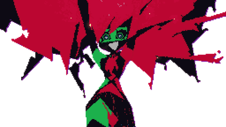 |  |  | 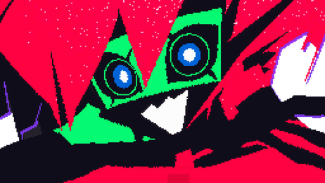 |

She changes expression depending on the situation, her mouth follows her voice, and what she says appears in a neon
speech bubble.

Tray menu (left click: show / hide; right click: menu):

| Entry | Purpose |
|:------|:--------|
| Show / Hide Capri | Toggle display |
| **Teleport** | Bottom/top, left/right, centre, random |
| **Size** | Small, medium, large |
| Automatic appearances / moves, text bubbles | Checkboxes |
| Clickable | Off: clicks go through Capri |
| **Voice** | On / off (she then keeps going with subtitles) |
| **Voice choice** | Automatic, Capri's voice, Piper, Windows, Edge (she says a phrase to try it) |
| **She talks...** | Never on her own / rarely / normally / a lot. She always answers when spoken to |
| Pause / Resume | Suspends listening |
| Economy mode | Fewer resources (automatic on battery) |
| Show status / Quit | |

**Checkpoint:** pick another entry in "Voice choice": she says a phrase to try it.

### Step 6 - Choose the Voice

<p align="center">
  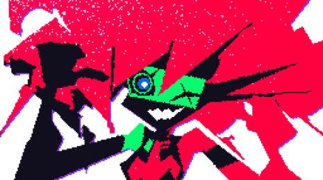
</p>

- By default: **Capri's voice**, generated offline by Pocket-TTS from `capri_french.safetensors`
  (`pip install pocket-tts`). The base French model is downloaded once on first launch, then cached.
- Automatic fallback: Piper neural voice (`installer_voix.py`, ≈ 65 MB), then the Windows voice (Hortense).
- `capri_config.json` → `voix`: `moteur` (`auto`, `capri`, `local` for Piper, `edge`, `windows`), `fichier_voix`,
  `volume`, `muet` (mute). `vitesse` and `hauteur` only apply to the fallback voices.

### Step 7 - Free Conversation (optional)

Without configuration, Capri answers with her built-in lines and offers a **web search** for open questions. To let
her chat freely with the same personality, connect a language model (OpenAI-compatible API) in `capri_config.json`,
section `llm`:

```json
"llm": {
  "actif": "auto",
  "url": "https://api.openai.com/v1",
  "modele": "gpt-4o-mini",
  "cle_env": "OPENAI_API_KEY"
}
```

- Put your key in the `OPENAI_API_KEY` environment variable (preferably over the `cle` field).
- **100% local and free**: install [Ollama](https://ollama.com), then `url` = `http://localhost:11434/v1`,
  `modele` = `llama3.1` (or another) and `"actif": true`.
- Any compatible API works (GitHub Models, LM Studio, OpenRouter...).

---

## 5. Architecture and Design

### 5.1 Overview

Capri is a small **multi-threaded** Python program: one thread captures the microphone, another recognises and
interprets speech, a third gives her initiative, while the avatar draws its translucent window and the tray icon
holds the menu.

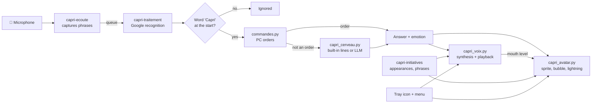

| Thread | Role |
|:-------|:-----|
| `capri-ecoute` | Reads the mic, cuts phrases, discards sound while she speaks |
| `capri-traitement` | Speech recognition, name detection, runs the request |
| `capri-initiatives` | Disappears, reappears, teleports, says phrases (`phrases.txt`) |
| Avatar window | Draws at ~30 frames/s in a translucent Windows window |
| Tray icon | Menu, option toggles |

### 5.2 From "Capri" to the Answer

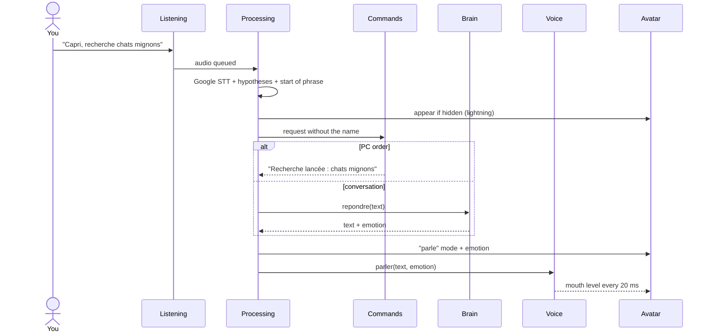

### 5.3 Name Recognition

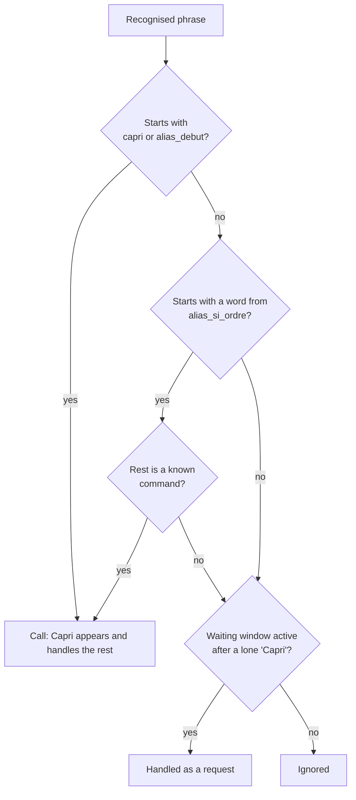

### 5.4 Voice Selection

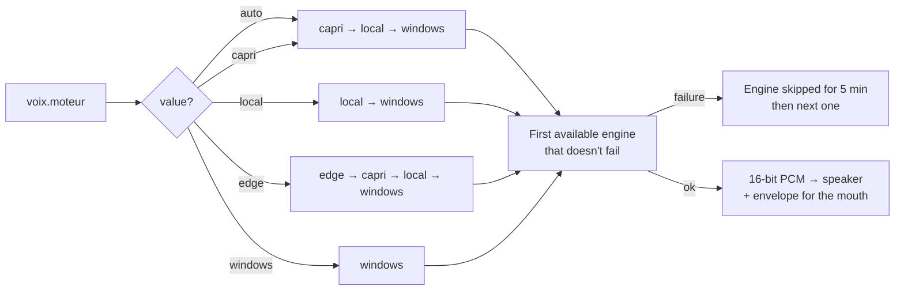

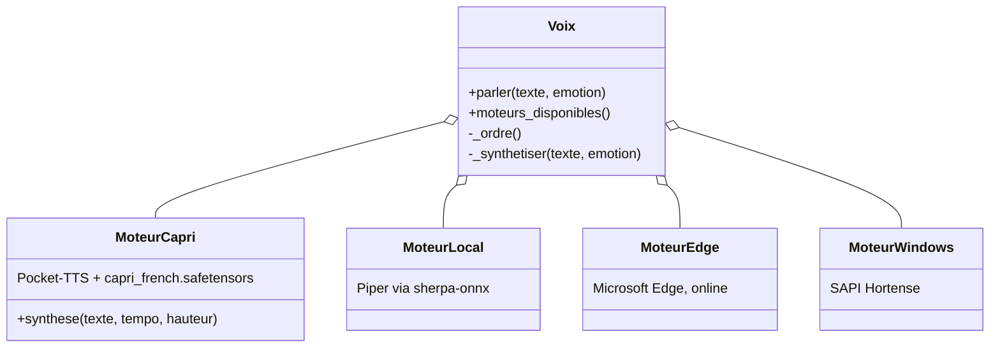

| Engine | Offline | Quality | Settings used |
|:-------|:-------:|:--------|:--------------|
| `capri` (Pocket-TTS) | ✅ | Capri's voice | `volume` |
| `local` (Piper) | ✅ | Good, fallback voice | `volume`, `vitesse`, `hauteur` |
| `edge` | ❌ | Very good | `volume`, `vitesse`, `hauteur` |
| `windows` (Hortense) | ✅ | Basic | `volume` |

### 5.5 The Brain: Three Levels of Answer

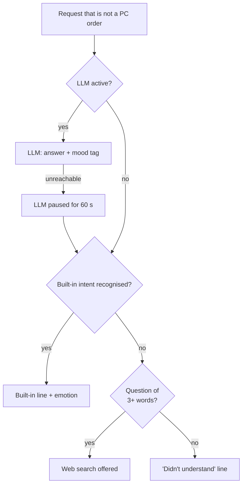

| Version | Configuration | Abilities |
|:--------|:--------------|:----------|
| **Built-in** (default) | None | Written lines for common intents (identity, mood, code...), web search for the rest |
| **Online LLM** | `llm.url` + key in `OPENAI_API_KEY` | Free conversation, personality enforced by a system prompt |
| **Local LLM** | Ollama, `url` = `http://localhost:11434/v1` | Same, free and offline |

The history keeps the last 12 messages; the LLM receives the date and time on every call.

### 5.6 Emotions and Expressions

Each answer carries an **emotion** (from the LLM through a tag in square brackets, or from the built-in line), which
picks the sprite. The mouth follows the voice at three levels (closed, half-open, open).

| Tag | Sprite | When |
|:----|:-------|:-----|
| `[neutre]` | `interested` | Default |
| `[enthousiaste]` | `excited` | A topic she likes, order executed |
| `[taquine]`, `[suspicieuse]` | `suspicious` | Irony, mystery about her nature |
| `[agacee]` | `annoyed` | Order not understood, failure |
| `[moi]` | `pointingatherself` | She talks about herself |
| `[montre]` | `pointing` | She offers a choice or points something out |
| `[detendue]` | `layingdown` | Leaving, resting, sleep |
| `[content]` | `happy` | Joy |
| `[surprise]` | `surprised` | Surprise |

The same tags are used in `phrases.txt`. The emotion also slightly shapes the voice (tempo and pitch) on the fallback
voices.

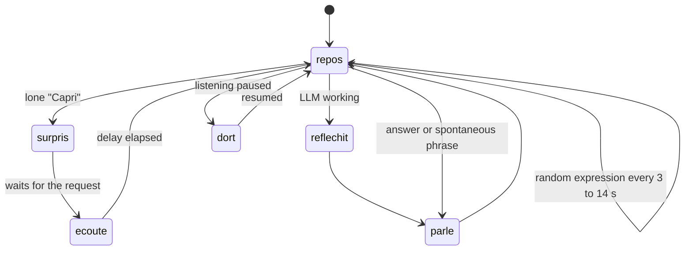

### 5.7 Spontaneous Initiatives

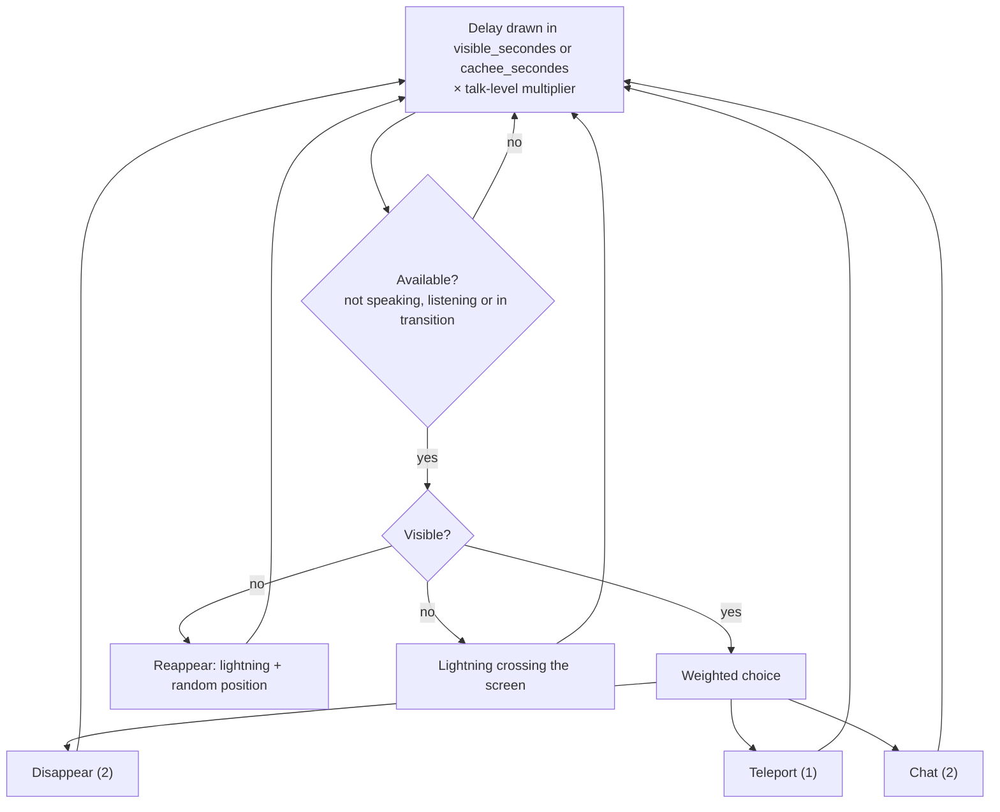

---

## 6. Technical Reference

### 6.1 Modules

| Module | Key classes / functions | Role |
|:-------|:------------------------|:-----|
| `assistant_vocal.py` | `AssistantVocal`, `Reconnaisseur` | Orchestration: mic, STT, menu, initiatives |
| `capri_avatar.py` | `AvatarCapri`, `FenetreCalque` | Translucent Win32 window (ctypes), sprites, lightning |
| `capri_voix.py` | `Voix`, `MoteurCapri`, `MoteurLocal`, `MoteurEdge`, `MoteurWindows` | Synthesis, playback, mouth sync |
| `capri_cerveau.py` | `Cerveau`, `ClientLLM`, `INTENTIONS`, `ETIQUETTES` | Personality, lines, LLM, wake word |
| `commandes.py` | `CommandeHandler` | PC orders (applications, web, volume...) |
| `capri_phrases.py` | `Phrases` | Hot reload of `phrases.txt` |
| `capri_config.py` | `charger`, `sauvegarder`, `DEFAUTS`, `MIGRATIONS` | Versioned settings |
| `capri_sprites.py` | | Loads and caches the images from `assets/` |

### 6.2 Settings and Migrations

`DEFAUTS` is merged with `capri_config.json`, so changing a default does not change an already saved value. To force a
new value once, bump `VERSION_CONFIG` and declare the key:

```python
VERSION_CONFIG = 3
MIGRATIONS = {
    2: [("phrases", "visible_secondes"), ("phrases", "cachee_secondes")],
    3: [("avatar", "positions")],
}
```

### 6.3 Bounded Microphone Threshold

The recognition library lets the energy threshold drift towards 1 in a silent room (the slightest breath then
triggers a recording). `Reconnaisseur` keeps it between `seuil_min` and `seuil_max`:

```python
class Reconnaisseur(sr.Recognizer):
    @property
    def energy_threshold(self):
        return self._seuil

    @energy_threshold.setter
    def energy_threshold(self, valeur):
        self._seuil = max(self.plancher, min(self.plafond, valeur))
```

### 6.4 Emotions: Mapping Table

```python
ETIQUETTES = {
    "neutre": "interested", "enthousiaste": "excited", "taquine": "suspicious", "agacee": "annoyed",
    "suspicieuse": "suspicious", "moi": "pointingatherself", "montre": "pointing",
    "detendue": "layingdown", "content": "happy", "surprise": "surprised",
}
```

The LLM must start its answer with one of these tags (it is not read aloud). `ClientLLM.repondre` strips it from the
text and converts it to a sprite.

### 6.5 Adding a Built-in Line

Each `INTENTIONS` entry pairs a name, a regular expression (applied to accent-free text) and lines
`(text, emotion)`. A line different from the previous one is drawn each time:

```python
("sommeil", r"(tu dors|tu es fatiguee|tu veux dormir|tu as sommeil)", [
    ("Dormir ? Mes processus tournent même quand je fais semblant de somnoler.", "layingdown"),
]),
```

### 6.6 Adding a Voice Engine

1. Write a class with `disponible()` and `synthese(texte, tempo, hauteur)` returning `(16-bit pcm, sample rate)`,
   like `MoteurCapri`.
2. Declare it in `Voix._moteur` and put its name in `Voix._ordre`.
3. Add it to the menu in `creer_menu` (`moteur("name", "Label")`).

```python
def synthese(self, texte, tempo, hauteur):
    audio = self.modele.generate_audio(self.etat, texte, max_tokens=300).numpy()
    pcm = array.array("h", (int(max(-1.0, min(1.0, float(s))) * 32000) for s in audio))
    return pcm, int(self.modele.sample_rate)
```

### 6.7 Talk Levels

```python
NIVEAUX_PAROLE = {
    "silencieuse": (0.0, False, 1.0),   # probability, free chatter, delay multiplier
    "discrete": (0.35, True, 2.0),
    "normale": (None, None, 1.0),       # None = values from the config file
    "bavarde": (1.0, True, 0.5),
}
```

### 6.8 Dependencies

| Package | Use |
|:--------|:----|
| `SpeechRecognition`, `PyAudio` | Microphone and Google recognition |
| `pocket-tts`, `torch` | Capri's voice |
| `sherpa-onnx` (< 2.0) | Piper fallback voice |
| `miniaudio` | Audio playback |
| `Pillow` | Sprite and lightning rendering |
| `pystray`, `pywin32` | Tray icon, windows |
| `pyautogui`, `psutil`, `pycaw` | Screenshots, processes, Windows volume |
| `requests` | LLM client |

---

## 7. Debugging and Pitfalls

| Symptom | Likely cause | How to confirm | Fix |
|:--------|:-------------|:---------------|:----|
| She can't hear me | Microphone not allowed | `verifier_permissions_micro.bat`, then `python test_microphone.py` | Allow the mic for desktop apps |
| She hears me "sometimes" | "Capri" misrecognised (café, tapis, prix...) | "hypothèses" lines in `capri_log.txt` | Add the word to `ecoute.alias_debut` |
| She reacts to every noise | `seuil_min` too low | The "Seuil d'énergie" line in the log | Raise `ecoute.seuil_min` (default 120) |
| She reacts to nothing | Threshold too high | Same | Lower `ecoute.seuil_max` (default 800) |
| She misses me often | She talks non-stop, so she is deaf | Very short `visible_secondes` / `cachee_secondes` | Restore `[30,120]` / `[15,75]` or lower `niveau_parole` |
| No recognition at all | No Internet | Test in a browser | Reconnect (Google recognition) |
| She won't start | Missing dependency | `lancer_assistant_debug.bat` shows the error | `installer_dependances.bat` |
| Windows voice instead of hers | `capri_french.safetensors` or `pocket-tts` missing | `capri_log.txt`: "Moteur vocal 'capri' en échec" | Restore the file, `pip install pocket-tts` |

Test options: `python assistant_vocal.py --muet` (no sound), `--sans-micro` (no listening).

---

## 8. Production Checklist

| Requirement | Done |
|:------------|:-----|
| The desktop shortcut launches Capri and the tray icon appears | |
| "Capri, quelle heure est-il ?" gets an answer | |
| While hidden, "Capri" alone makes her appear and listen | |
| She appears at random positions on the screen | |
| The voice picked in the menu is the one used | |
| `niveau_parole` visibly changes how often she talks | |

---

## 9. Extension

- **Her phrases**: add your own lines to `phrases.txt`, with a mood per line.
- **Her look**: replace the images in `assets/` (see `capri_sprites.py`); file names must follow the same pattern.
- **Start with Windows**: `installer_au_demarrage.bat` (and `desinstaller_demarrage.bat` to remove it).

---

## 10. Project Files

| File | Purpose |
|:-----|:--------|
| `assistant_vocal.py` | Main program (listening, tray, orchestration) |
| `capri_avatar.py` | Avatar: translucent window, animations, effects |
| `capri_sprites.py` | Loads the images from the `assets` folder |
| `capri_phrases.py` / `phrases.txt` | Spontaneous phrases |
| `capri_voix.py` | Speech synthesis + mouth sync |
| `capri_cerveau.py` | Personality, replies, LLM connection |
| `commandes.py` | PC commands (applications, web, volume...) |
| `capri_config.json` | Settings (created on first launch) |
| `capri_french.safetensors` | Capri's voice |
| `lancer_assistant.bat` / `_debug.bat` | Start Capri (background / with messages) |
| `creer_raccourci_bureau.bat` | Creates the desktop shortcut |
| `installer_au_demarrage.bat` / `desinstaller_demarrage.bat` | Start automatically with Windows |
| `installer_dependances.bat` / `installer_voix.py` | Dependencies and fallback voice |

---

<p align="center"><sub>Capri 2.0 – formerly Carl · <a href="GUIDE_UTILISATION.md">Version française</a></sub></p>
